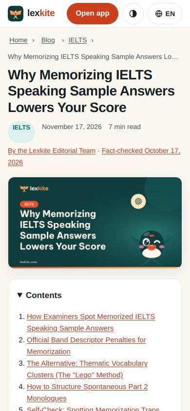
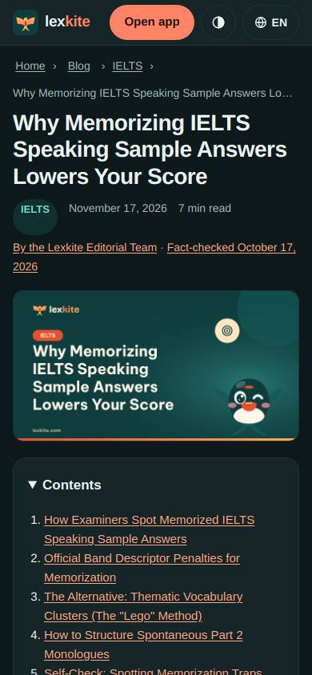
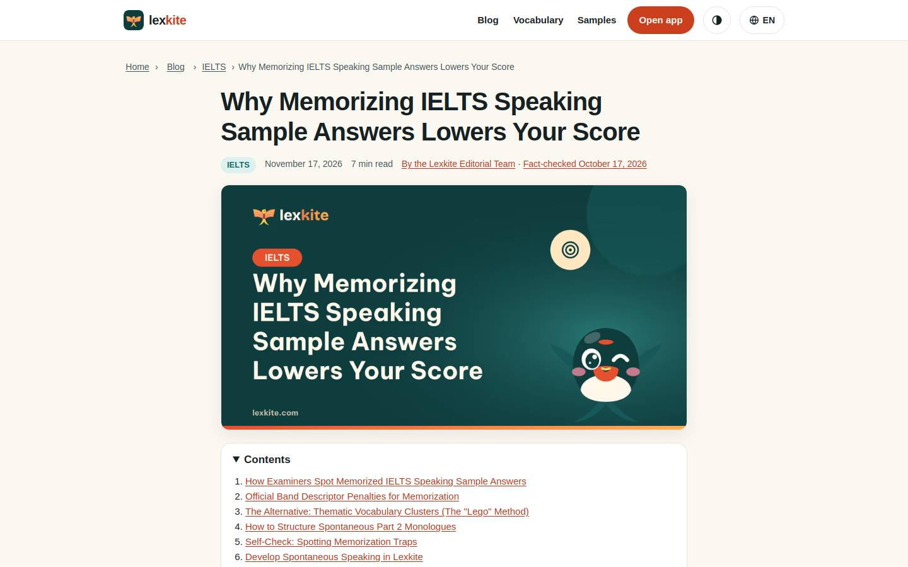
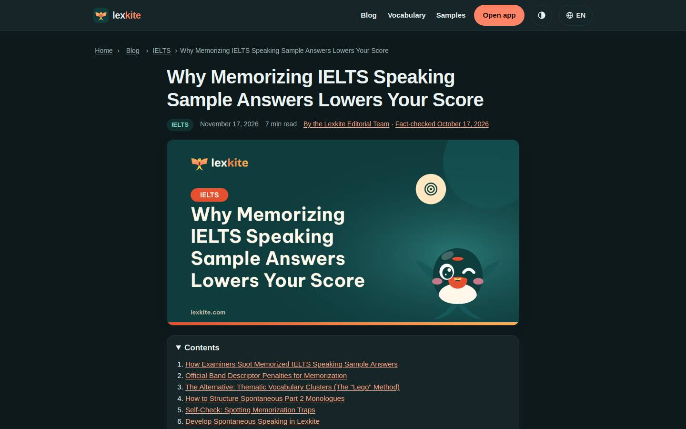

# /L/blog/*/

Điểm: **92** · độ phủ 100 % · /en/blog/why-memorizing-sample-answers-ruins-ielts-speaking/

- Chức năng: 100
- Lỗi JS: 100
- Rỗng/lỗi/tải: –
- Back/Thoát: –
- Tương phản: 100
- Chạm ≥44: 44
- Bố cục: 96
- i18n 15: 100
- Hiệu năng: 100
- Độ đẹp: 72

## Lỗi
- [tap] ol>li>a – "How to Structure Spontaneous Part 2 Mono" vùng chạm 248×41 < 44px
- [tap] ul>li>a – "English level test" vùng chạm 139×29 < 44px
- [tap] article.post>div.tags>a – "#ielts-speaking" vùng chạm 119×32 < 44px
- [tap] aside.cta.ext-box>div.cta-actions>button.btn-hide – "Hide" vùng chạm 39×30 < 44px
- [tap] aside.cta.pwa-box>div.cta-actions>button.btn-hide – "Hide" vùng chạm 39×30 < 44px
- [layout] main#nd>nav.crumbs>span – chữ bị cắt "…" (438>358px)
- [beauty] Generic blog layout, not a polished app screen
- [beauty] Card illustration feels pasted on, not integrated
- [beauty] Red link color clashes with orange brand accent

## Ảnh
390l 
390d 
1440l 
1440d 
