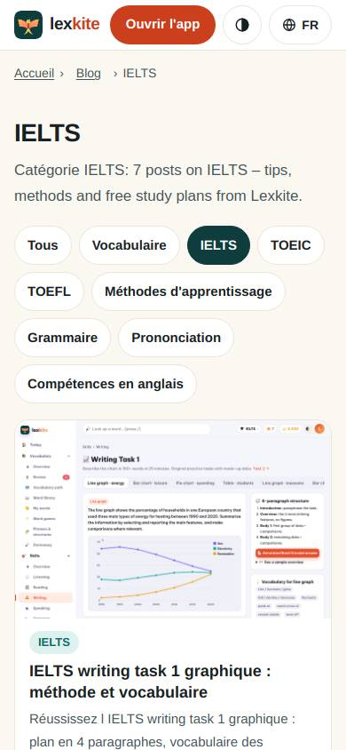
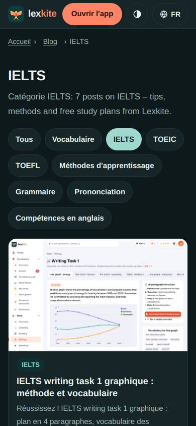
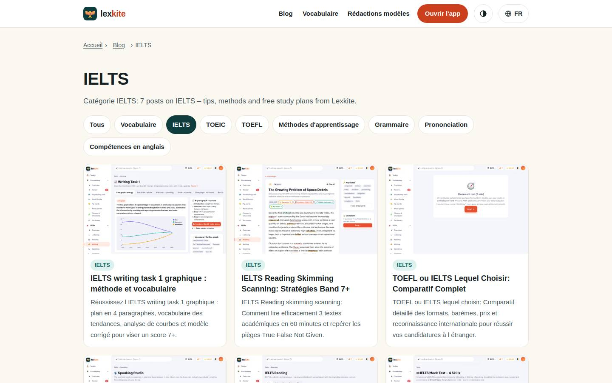
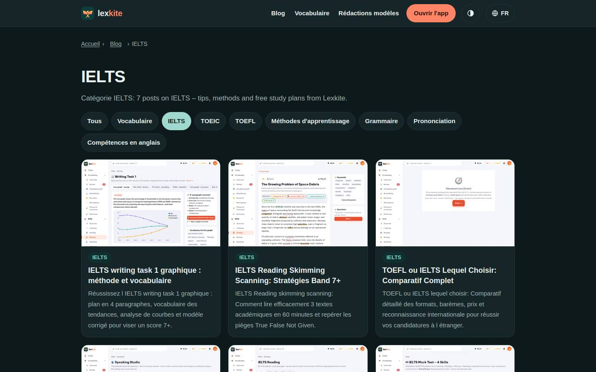

# /L/blog/categorie/*/

Điểm: **93** · độ phủ 100 % · /fr/blog/categorie/ielts/

- Chức năng: 90
- Lỗi JS: 100
- Rỗng/lỗi/tải: –
- Back/Thoát: –
- Tương phản: 100
- Chạm ≥44: 100
- Bố cục: 100
- i18n 15: 100
- Hiệu năng: 100
- Độ đẹp: 72

## Lỗi
- [fn] link hỏng: /fr/words/
- [beauty] Screenshot embedded as a raw, low-res image rather than a native UI card
- [beauty] No clear primary action; filter pills compete for attention
- [beauty] Generic web-blog layout lacks Duolingo's playful character integration

## Ảnh
390l 
390d 
1440l 
1440d 
