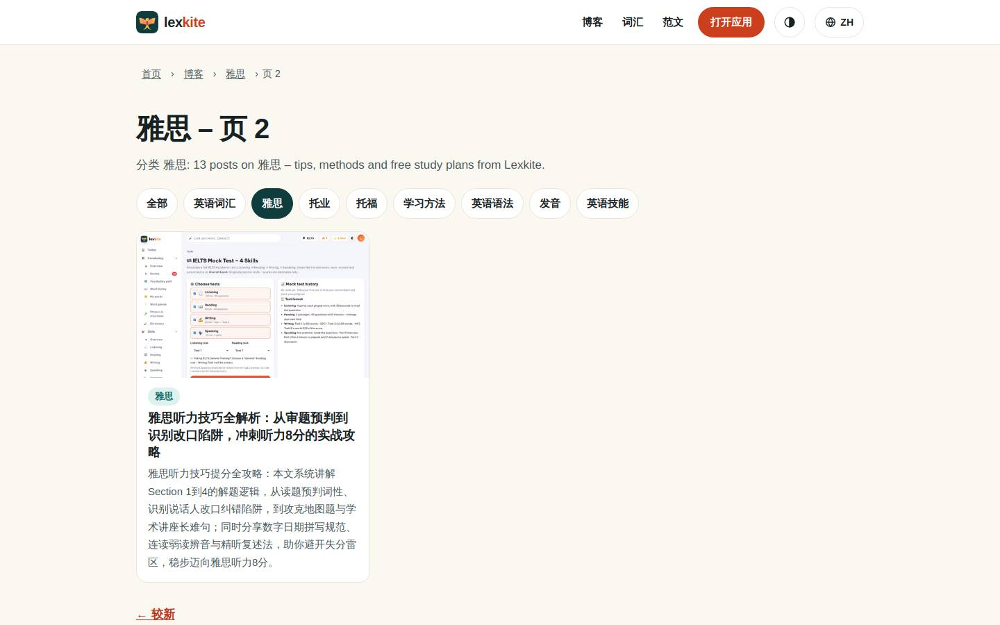

# /L/blog/category/ielts/page/*/

Điểm: **98** · độ phủ 84 % · /zh/blog/category/ielts/page/2/

- Chức năng: 90
- Lỗi JS: 100
- Rỗng/lỗi/tải: –
- Back/Thoát: –
- Tương phản: 100
- Chạm ≥44: 100
- Bố cục: 100
- i18n 15: 100
- Hiệu năng: 100
- Độ đẹp: ∅

## Lỗi
- [fn] link hỏng: /zh/words/

## Ảnh
390l 
390d 
1440l 
1440d 
