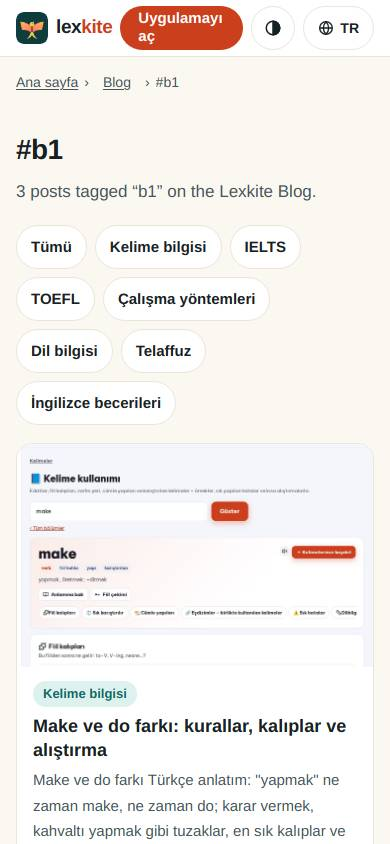
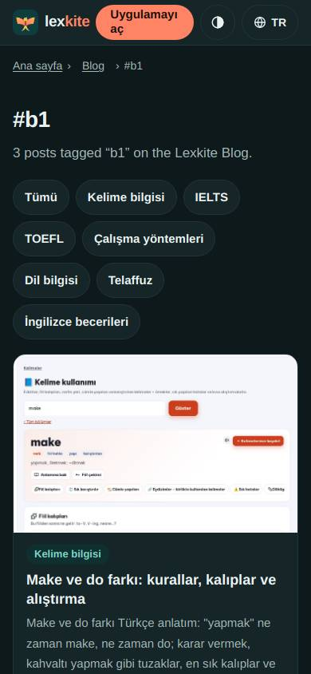
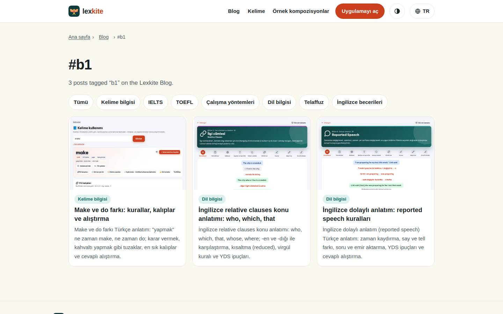
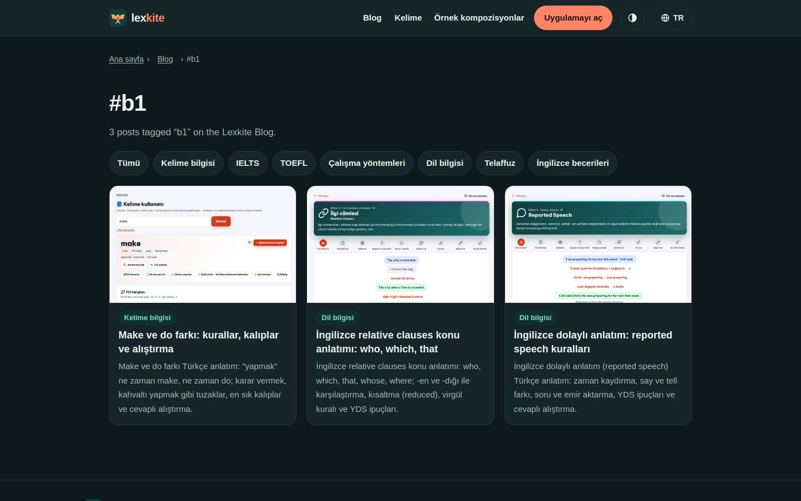

# /L/blog/etiket/*/

Điểm: **93** · độ phủ 100 % · /tr/blog/etiket/b1/

- Chức năng: 90
- Lỗi JS: 100
- Rỗng/lỗi/tải: –
- Back/Thoát: –
- Tương phản: 100
- Chạm ≥44: 100
- Bố cục: 100
- i18n 15: 100
- Hiệu năng: 100
- Độ đẹp: 72

## Lỗi
- [fn] link hỏng: /tr/words/
- [beauty] Blog layout feels generic, not app-like
- [beauty] Card thumbnail is a blurry screenshot, low polish
- [beauty] No character/illustration integration

## Ảnh
390l 
390d 
1440l 
1440d 
