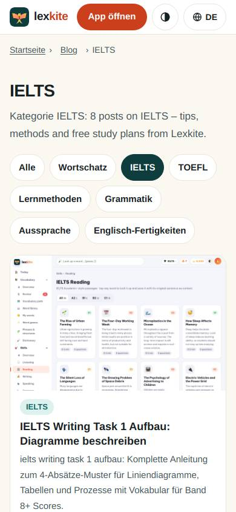
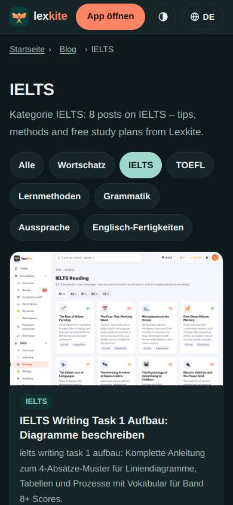
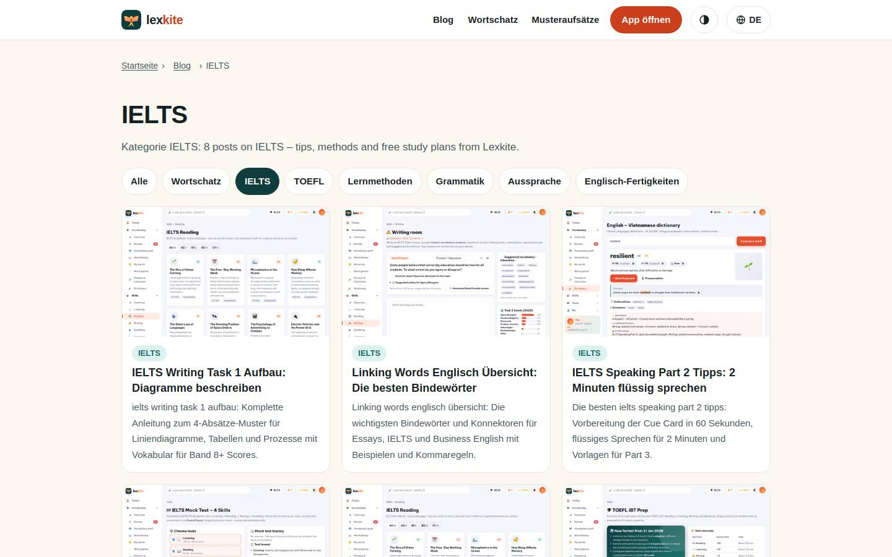
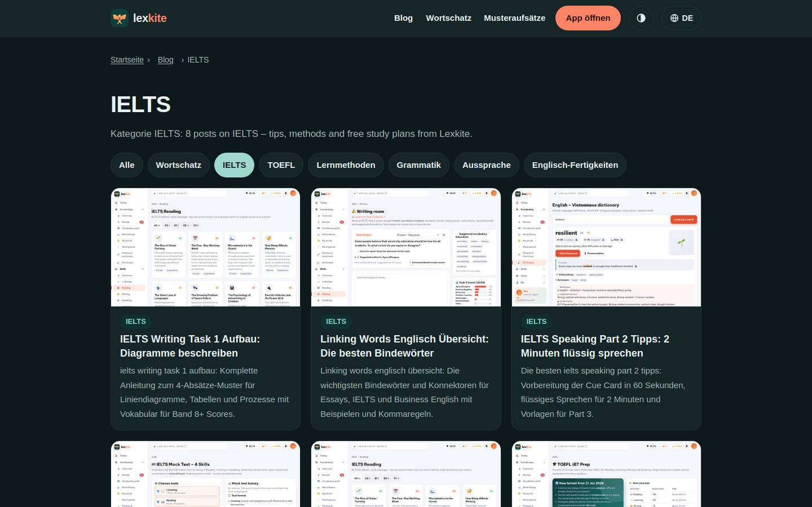

# /L/blog/kategorie/*/

Điểm: **93** · độ phủ 100 % · /de/blog/kategorie/ielts/

- Chức năng: 90
- Lỗi JS: 100
- Rỗng/lỗi/tải: –
- Back/Thoát: –
- Tương phản: 100
- Chạm ≥44: 100
- Bố cục: 100
- i18n 15: 100
- Hiệu năng: 100
- Độ đẹp: 72

## Lỗi
- [fn] link hỏng: /de/words/
- [beauty] Embedded app screenshot is low-res and blurry
- [beauty] Generic web layout lacks Duolingo's playful character integration
- [beauty] Filter pills feel like default UI, not polished app components

## Ảnh
390l 
390d 
1440l 
1440d 
