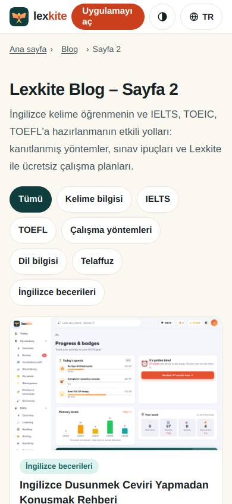
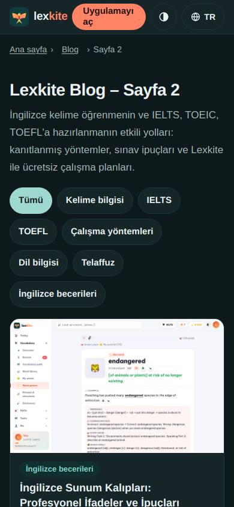
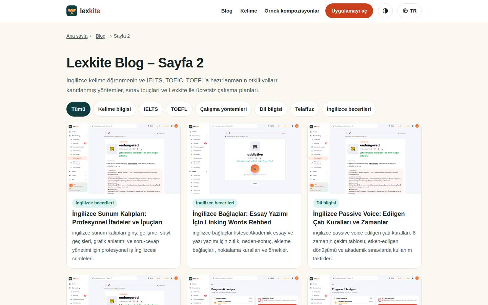
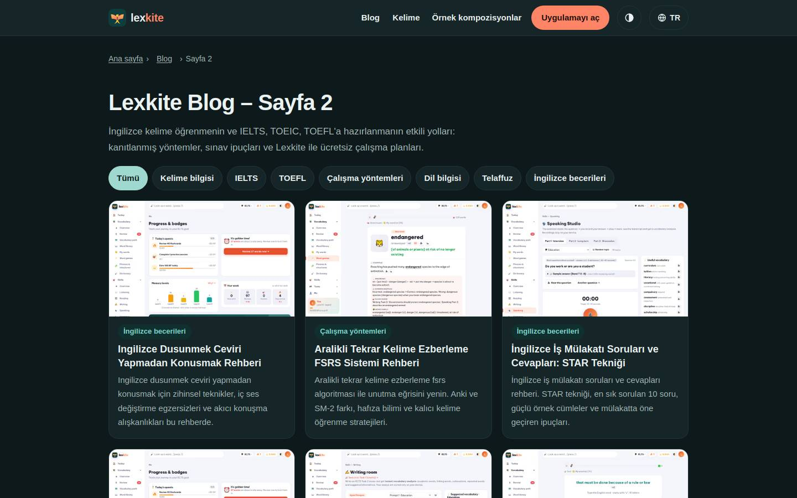

# /L/blog/sayfa/*/

Điểm: **93** · độ phủ 100 % · /tr/blog/sayfa/2/

- Chức năng: 90
- Lỗi JS: 100
- Rỗng/lỗi/tải: –
- Back/Thoát: –
- Tương phản: 100
- Chạm ≥44: 100
- Bố cục: 100
- i18n 15: 100
- Hiệu năng: 100
- Độ đẹp: 72

## Lỗi
- [fn] link hỏng: /tr/words/
- [beauty] Generic web layout, not app-like Duolingo polish
- [beauty] Screenshot card looks pasted, low-res and cluttered
- [beauty] Weak visual hierarchy; tags feel like raw HTML pills

## Ảnh
390l 
390d 
1440l 
1440d 
