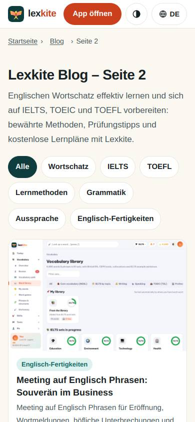
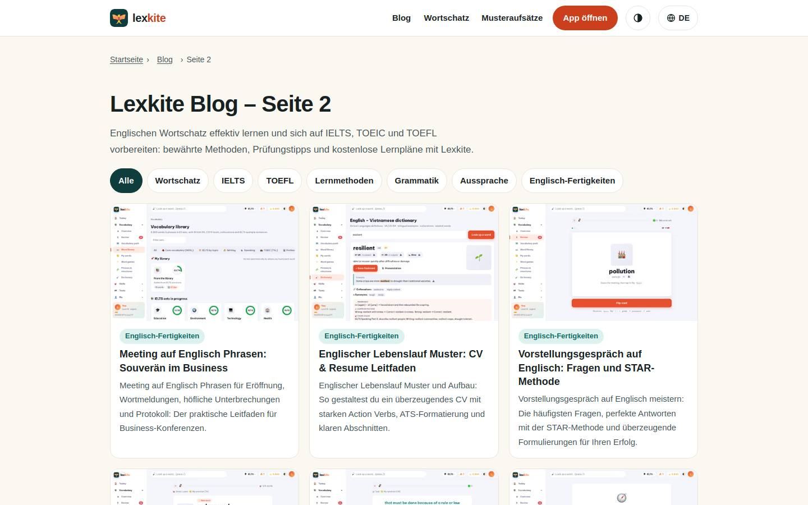
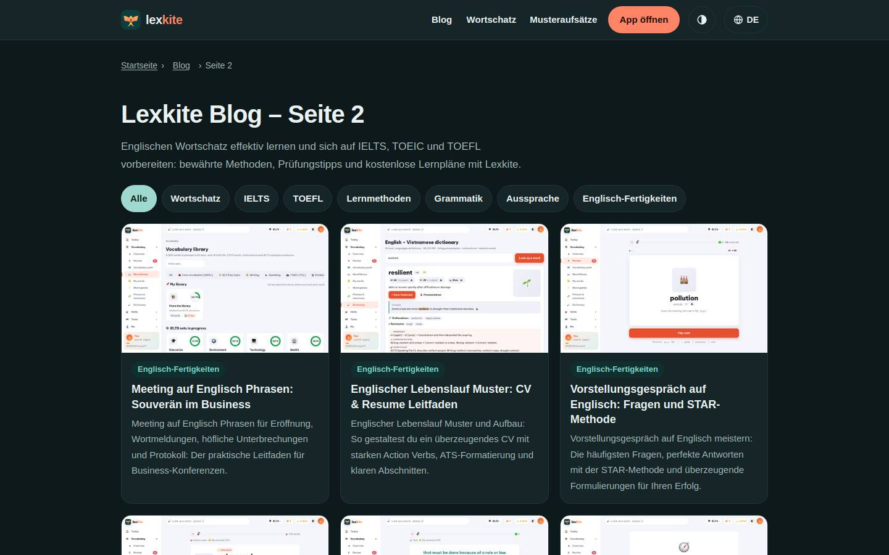

# /L/blog/seite/*/

Điểm: **93** · độ phủ 100 % · /de/blog/seite/2/

- Chức năng: 90
- Lỗi JS: 100
- Rỗng/lỗi/tải: –
- Back/Thoát: –
- Tương phản: 100
- Chạm ≥44: 100
- Bố cục: 100
- i18n 15: 100
- Hiệu năng: 100
- Độ đẹp: 72

## Lỗi
- [fn] link hỏng: /de/words/
- [beauty] Embedded screenshot looks like a raw, low-res paste, not a designed card.
- [beauty] No clear primary action; CTA is buried in a dense blog header.
- [beauty] Generic pill filters and plain text lack Duolingo's playful character integration.

## Ảnh
390l 
390d 
1440l 
1440d 
