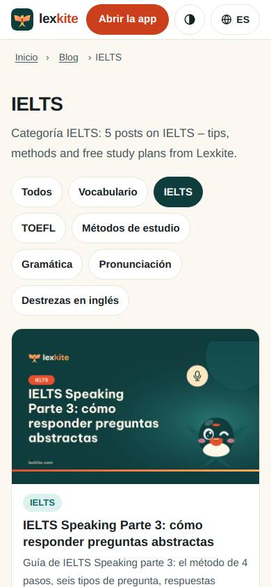
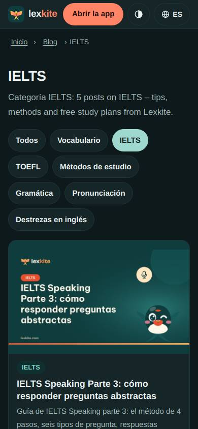
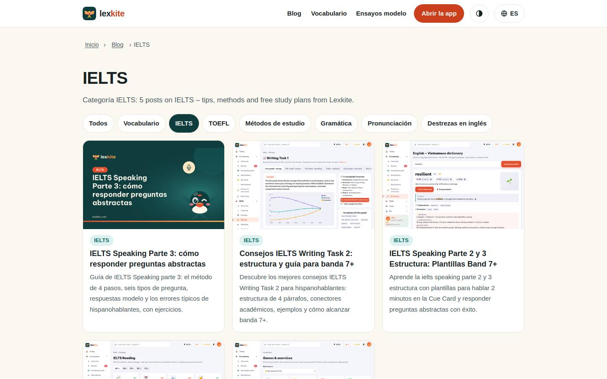
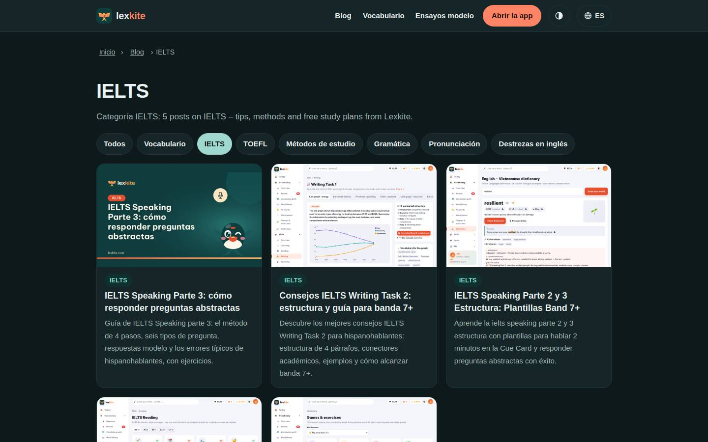

# /L/blog/tema/*/

Điểm: **96** · độ phủ 100 % · /es/blog/tema/ielts/

- Chức năng: 100
- Lỗi JS: 100
- Rỗng/lỗi/tải: –
- Back/Thoát: –
- Tương phản: 100
- Chạm ≥44: 100
- Bố cục: 100
- i18n 15: 100
- Hiệu năng: 100
- Độ đẹp: 77

## Lỗi
- [beauty] Card image feels like a pasted banner, not integrated UI
- [beauty] Tag pill row lacks consistent spacing rhythm
- [beauty] Header icons feel generic compared to Duolingo polish

## Ảnh
390l 
390d 
1440l 
1440d 
