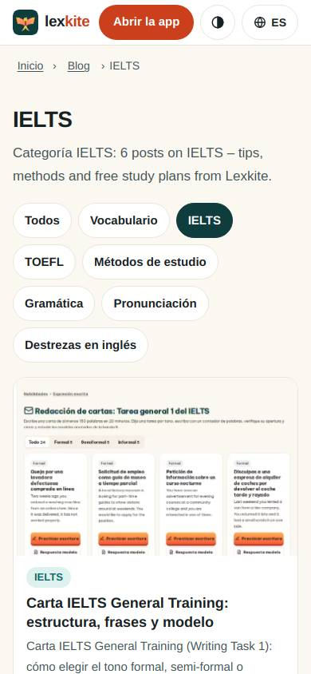
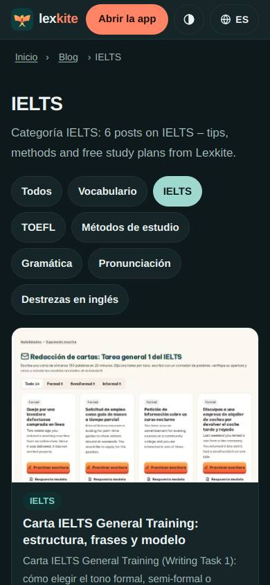
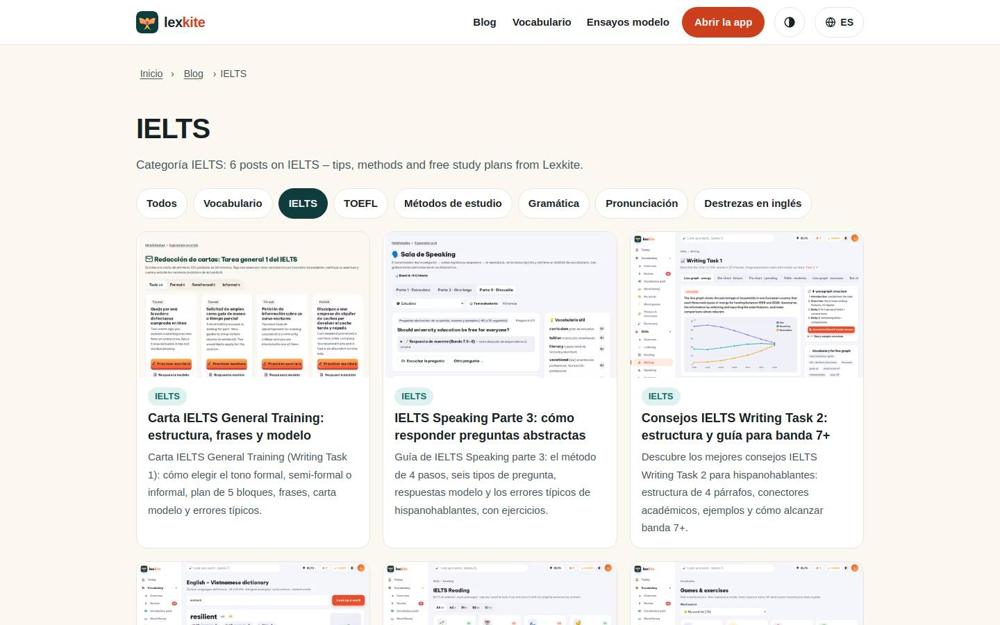
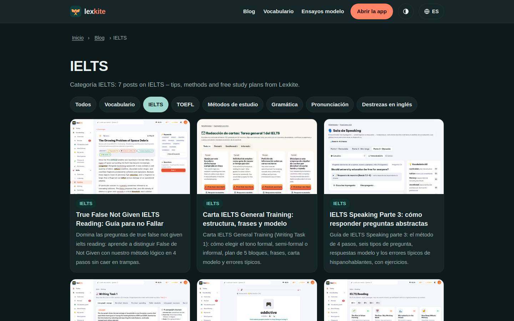

# /L/blog/tema/*/

Điểm: **93** · độ phủ 100 % · /es/blog/tema/ielts/

- Chức năng: 90
- Lỗi JS: 100
- Rỗng/lỗi/tải: –
- Back/Thoát: –
- Tương phản: 100
- Chạm ≥44: 100
- Bố cục: 100
- i18n 15: 100
- Hiệu năng: 100
- Độ đẹp: 72

## Lỗi
- [fn] link hỏng: /es/words/
- [beauty] Embedded screenshot looks like a raw, low-res paste, not integrated UI
- [beauty] No clear primary action; header CTA competes with filter pills
- [beauty] Generic sans-serif and flat cards feel utilitarian, not Duolingo-polished

## Ảnh
390l 
390d 
1440l 
1440d 
