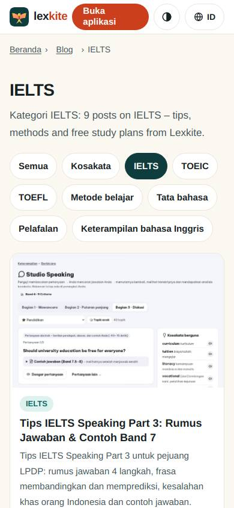
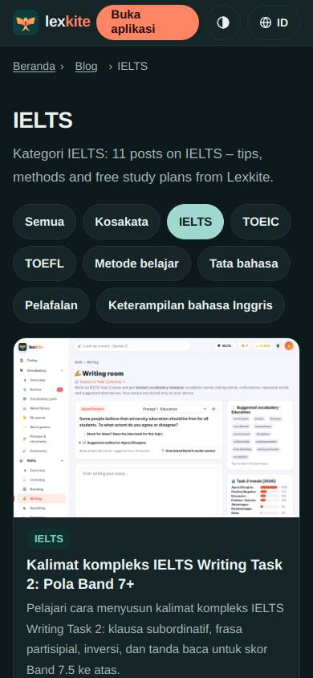
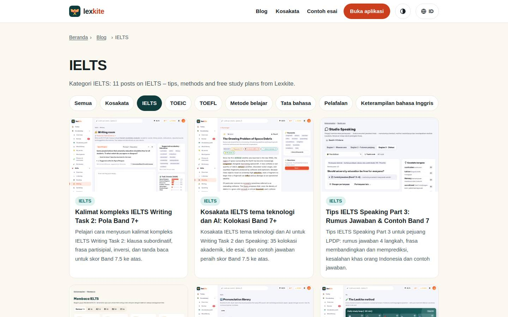
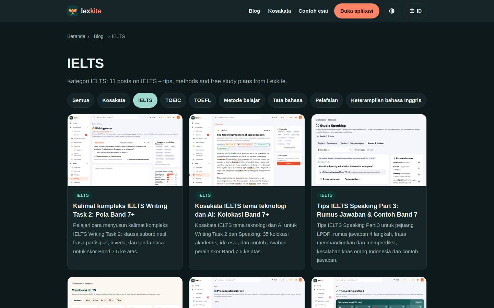

# /L/blog/topik/*/

Điểm: **93** · độ phủ 100 % · /id/blog/topik/ielts/

- Chức năng: 90
- Lỗi JS: 100
- Rỗng/lỗi/tải: –
- Back/Thoát: –
- Tương phản: 100
- Chạm ≥44: 100
- Bố cục: 100
- i18n 15: 100
- Hiệu năng: 100
- Độ đẹp: 72

## Lỗi
- [fn] link hỏng: /id/words/
- [beauty] No character or illustration integration, feels like a generic blog
- [beauty] Card thumbnail is a low-res, blurry screenshot
- [beauty] Header layout is plain and lacks Duolingo's playful polish

## Ảnh
390l 
390d 
1440l 
1440d 
