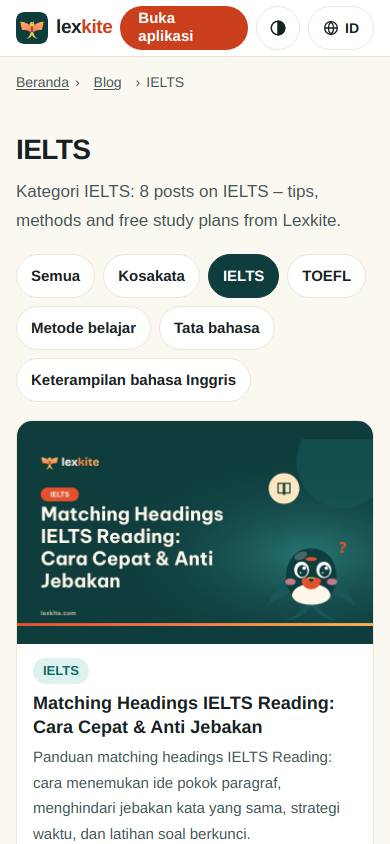
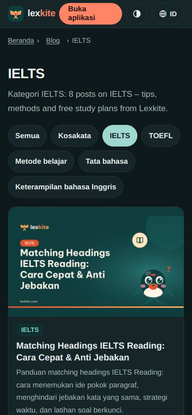
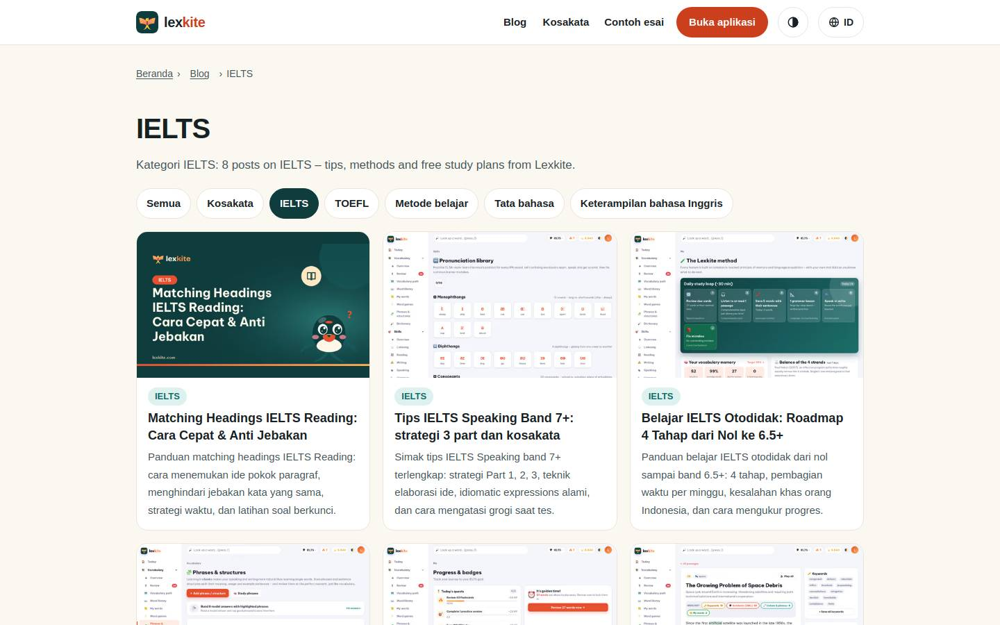
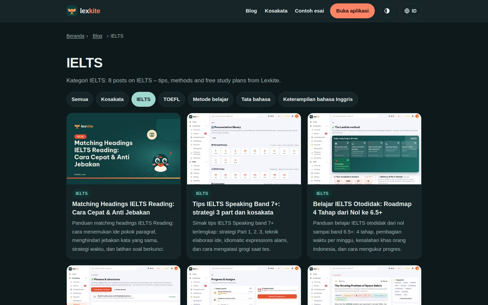

# /L/blog/topik/*/

Điểm: **96** · độ phủ 100 % · /id/blog/topik/ielts/

- Chức năng: 100
- Lỗi JS: 100
- Rỗng/lỗi/tải: –
- Back/Thoát: –
- Tương phản: 100
- Chạm ≥44: 100
- Bố cục: 100
- i18n 15: 100
- Hiệu năng: 100
- Độ đẹp: 74

## Lỗi
- [beauty] Header feels like a web nav, not an app bar
- [beauty] Filter pills wrap unevenly, breaking rhythm
- [beauty] Card illustration feels pasted, not integrated

## Ảnh
390l 
390d 
1440l 
1440d 
