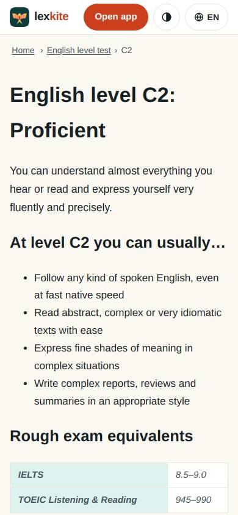
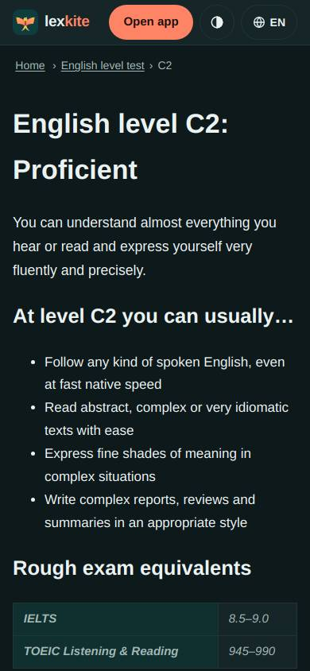
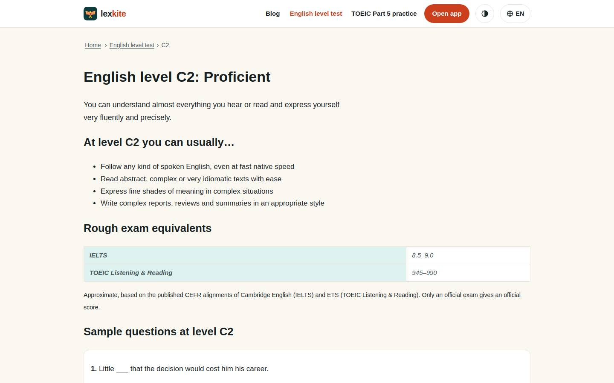
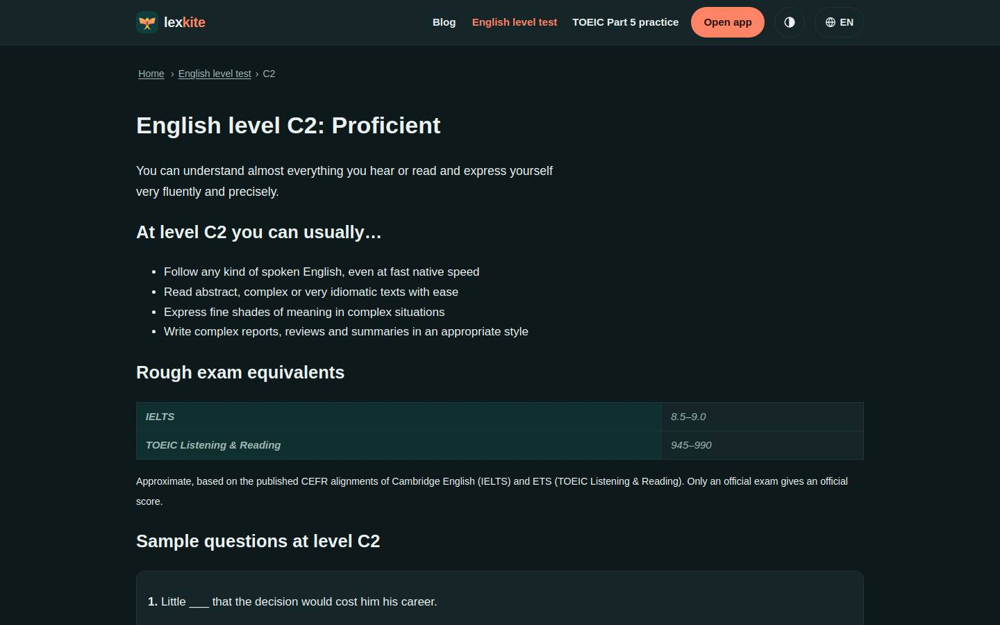

# /L/english-level-test/*/

Điểm: **95** · độ phủ 100 % · /en/english-level-test/c2/

- Chức năng: 100
- Lỗi JS: 100
- Rỗng/lỗi/tải: –
- Back/Thoát: –
- Tương phản: 100
- Chạm ≥44: 100
- Bố cục: 100
- i18n 15: 100
- Hiệu năng: 100
- Độ đẹp: 67

## Lỗi
- [beauty] Generic web layout, not a polished app UI
- [beauty] No character or illustration integration
- [beauty] Flat, low-contrast table styling

## Ảnh
390l 
390d 
1440l 
1440d 
