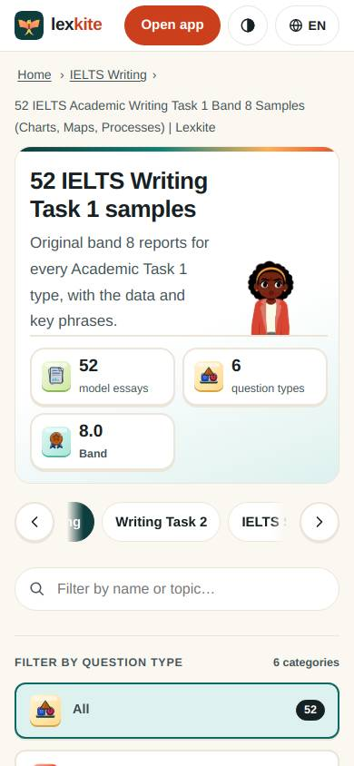
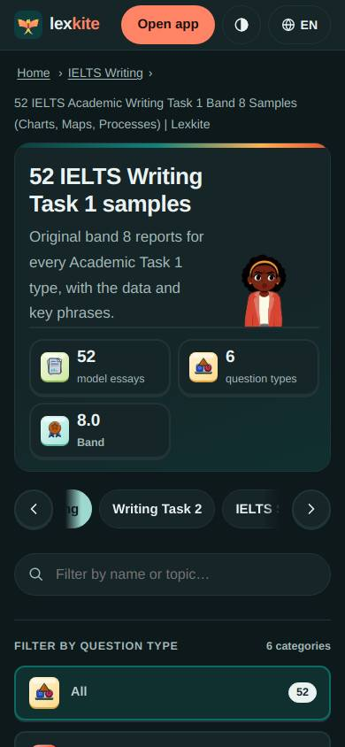
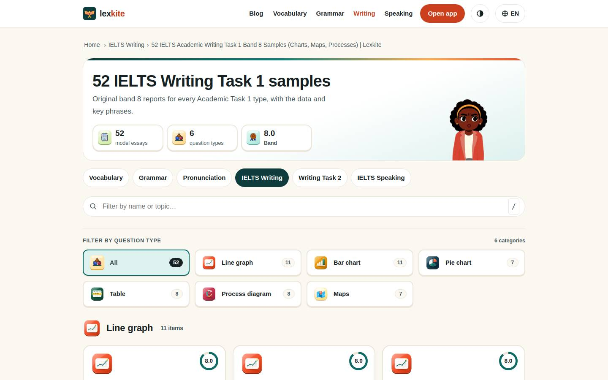
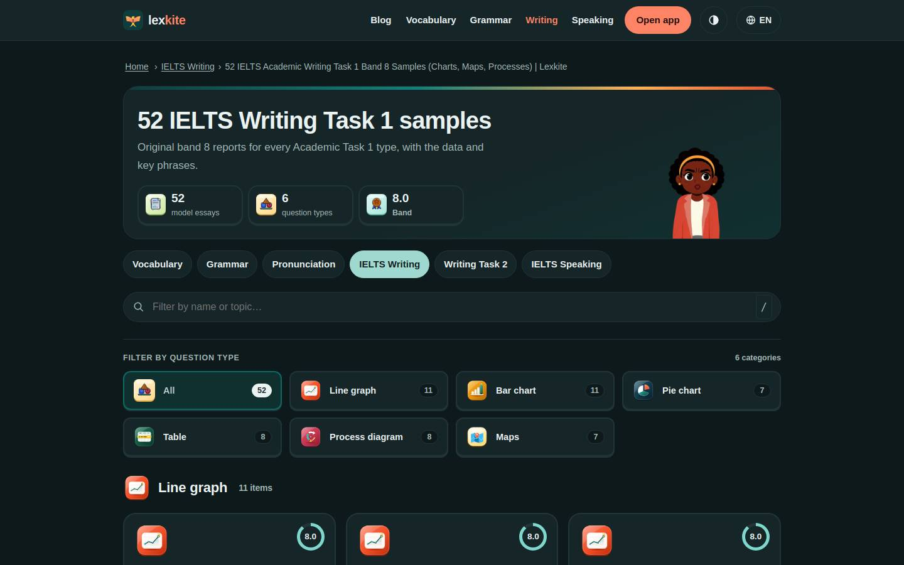

# /L/ielts-writing/*/

Điểm: **96** · độ phủ 100 % · /en/ielts-writing/task-1/

- Chức năng: 100
- Lỗi JS: 100
- Rỗng/lỗi/tải: –
- Back/Thoát: –
- Tương phản: 100
- Chạm ≥44: 100
- Bố cục: 85
- i18n 15: 100
- Hiệu năng: 100
- Độ đẹp: 83

## Lỗi
- [layout] div.tfw.ovf>nav.cats>a – "Vocabulary" lòi ra ngoài div.page.smp>div.tfw.ovf>nav.cats 448px
- [beauty] Character illustration feels pasted, not integrated with layout
- [beauty] Top nav 'Open app' button competes with content hierarchy
- [beauty] Filter chips row has uneven spacing and cut-off text

## Ảnh
390l 
390d 
1440l 
1440d 
