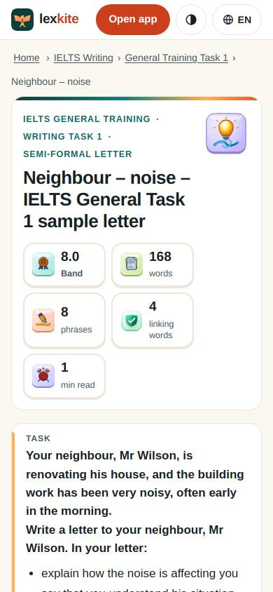
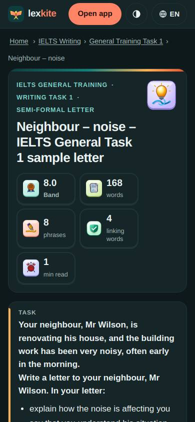
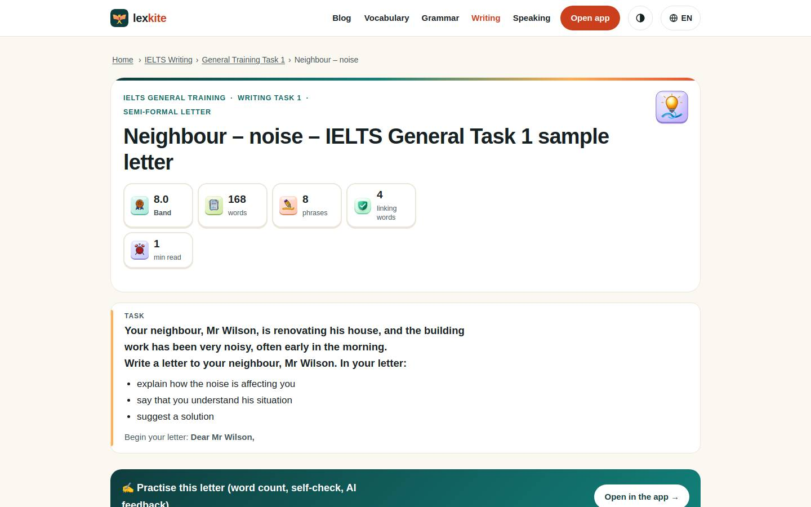
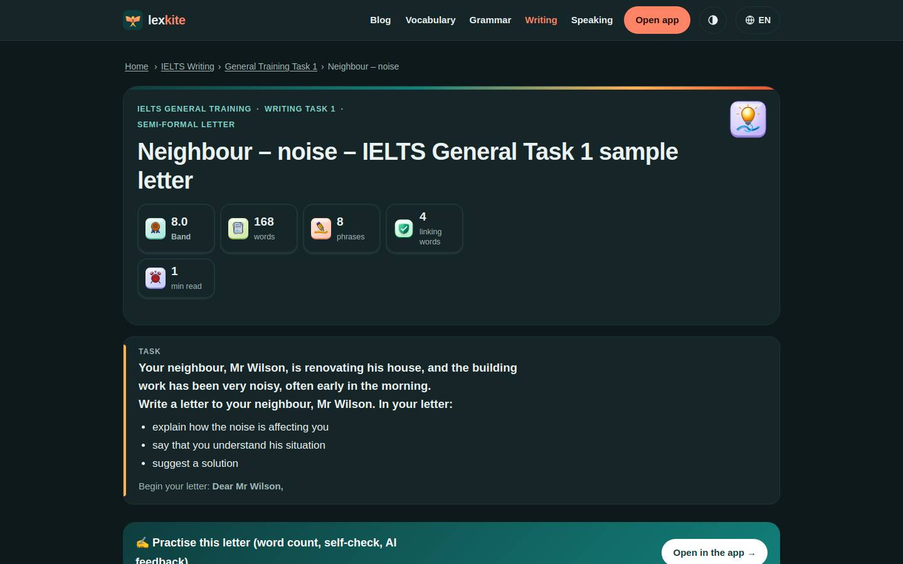

# /L/ielts-writing/general-task-1/*

Điểm: **97** · độ phủ 100 % · /en/ielts-writing/general-task-1/gt9.html

- Chức năng: 100
- Lỗi JS: 100
- Rỗng/lỗi/tải: –
- Back/Thoát: –
- Tương phản: 100
- Chạm ≥44: 84
- Bố cục: 100
- i18n 15: 100
- Hiệu năng: 100
- Độ đẹp: 84

## Lỗi
- [tap] div.side-box.legend>div.tools>button – "Highlights" vùng chạm 105×32 < 44px
- [tap] aside#ext>div.cta-actions>button.btn-hide – "Hide" vùng chạm 41×26 < 44px
- [beauty] Header feels like a web app, not a mobile learning app
- [beauty] Stat cards are generic; icons lack Duolingo-level character
- [beauty] No clear primary action on the content card

## Ảnh
390l 
390d 
1440l 
1440d 
