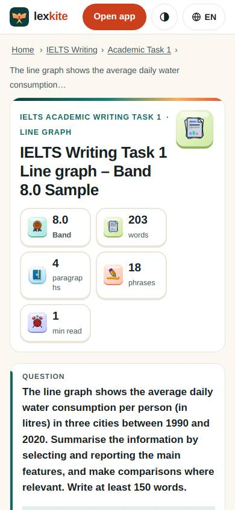
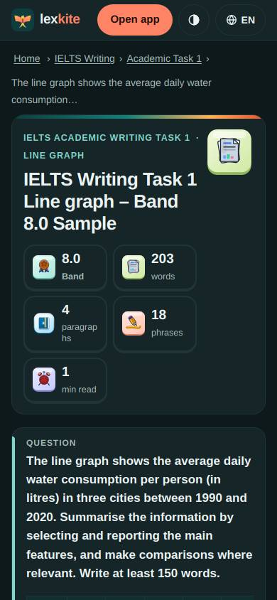
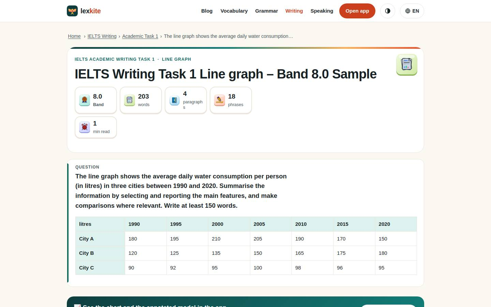
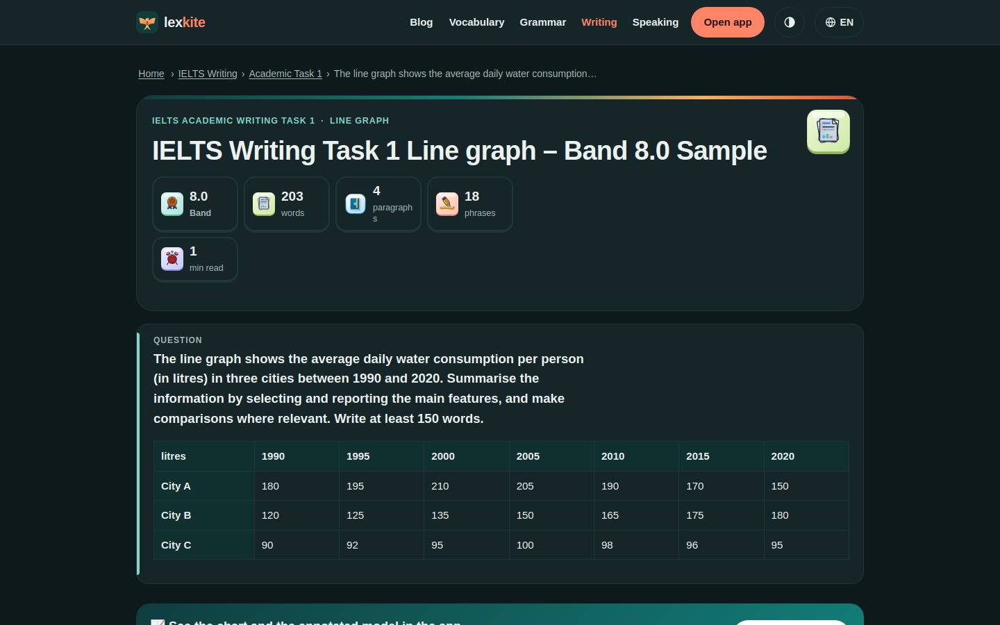

# /L/ielts-writing/task-1/*

Điểm: **97** · độ phủ 84 % · /en/ielts-writing/task-1/water.html

- Chức năng: 100
- Lỗi JS: 100
- Rỗng/lỗi/tải: –
- Back/Thoát: –
- Tương phản: 100
- Chạm ≥44: 84
- Bố cục: 85
- i18n 15: 100
- Hiệu năng: 100
- Độ đẹp: ∅

## Lỗi
- [tap] div.side-box.legend>div.tools>button – "Highlights" vùng chạm 105×32 < 44px
- [tap] aside#ext>div.cta-actions>button.btn-hide – "Hide" vùng chạm 41×26 < 44px
- [layout] article.page.smp>section.prompt>div.tbl – nội dung tràn ngang 118px bị cắt: "2010", "2015", "2020"

## Ảnh
390l 
390d 
1440l 
1440d 
