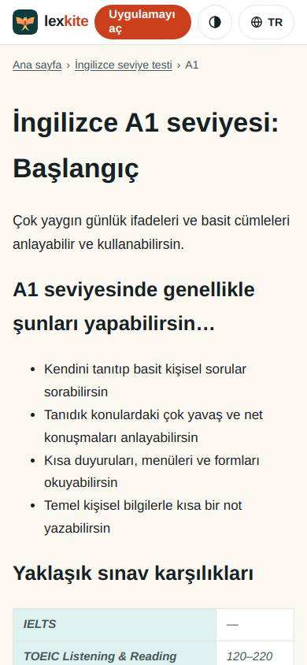
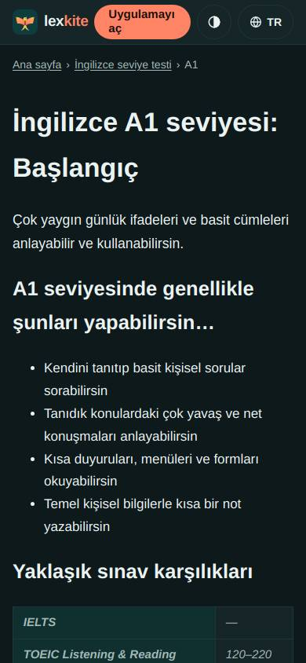
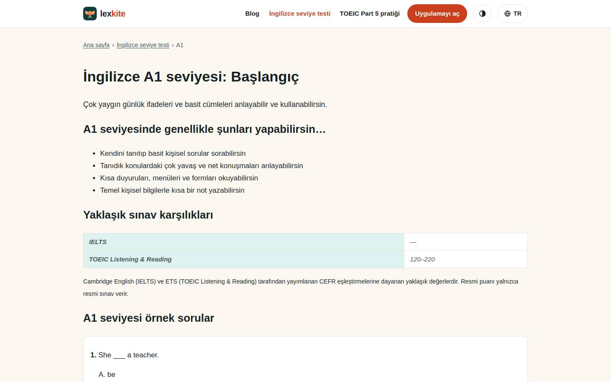
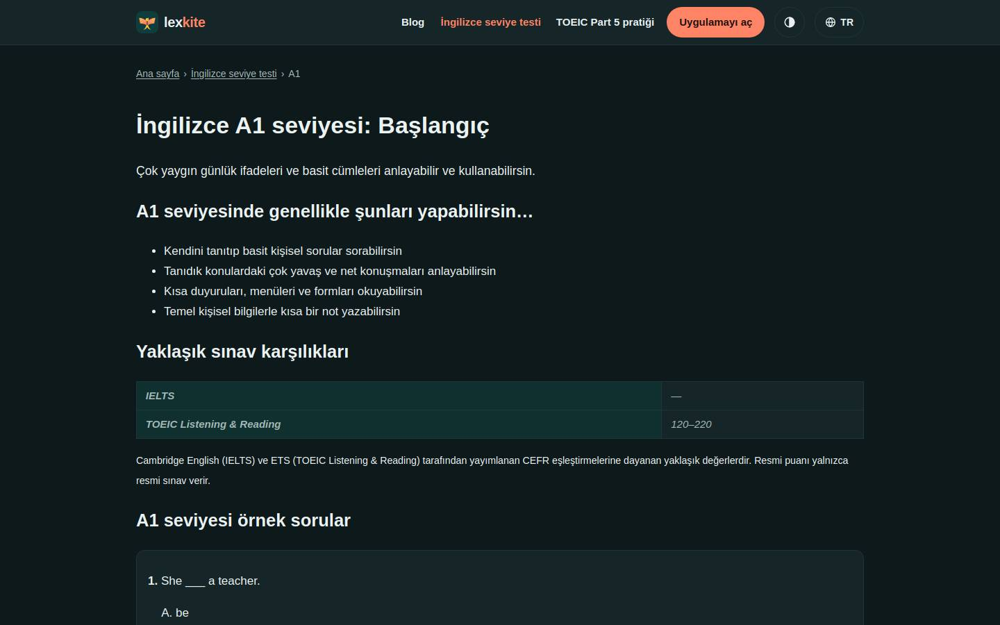

# /L/ingilizce-seviye-testi/*/

Điểm: **93** · độ phủ 100 % · /tr/ingilizce-seviye-testi/a1/

- Chức năng: 100
- Lỗi JS: 100
- Rỗng/lỗi/tải: –
- Back/Thoát: –
- Tương phản: 100
- Chạm ≥44: 100
- Bố cục: 100
- i18n 15: 100
- Hiệu năng: 100
- Độ đẹp: 57

## Lỗi
- [beauty] Lacks Duolingo's playful character illustrations and gamified visual elements
- [beauty] Layout is a plain text document, not a polished app interface
- [beauty] Generic table styling looks unfinished and raw

## Ảnh
390l 
390d 
1440l 
1440d 
