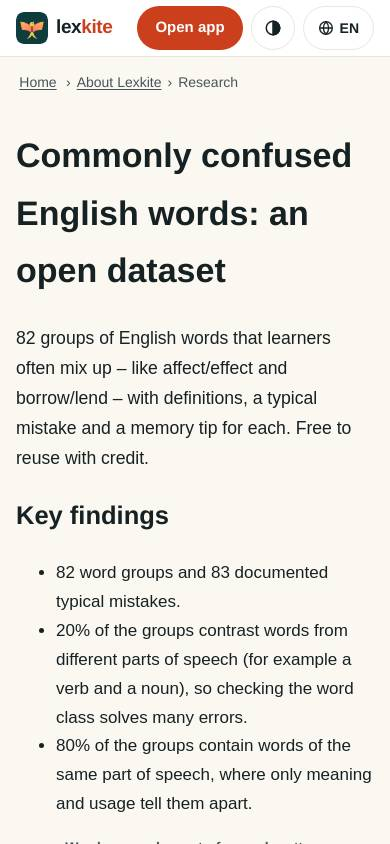
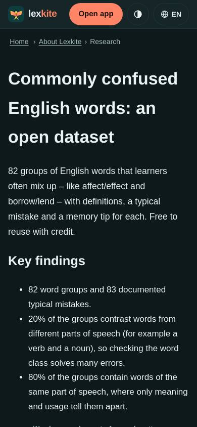
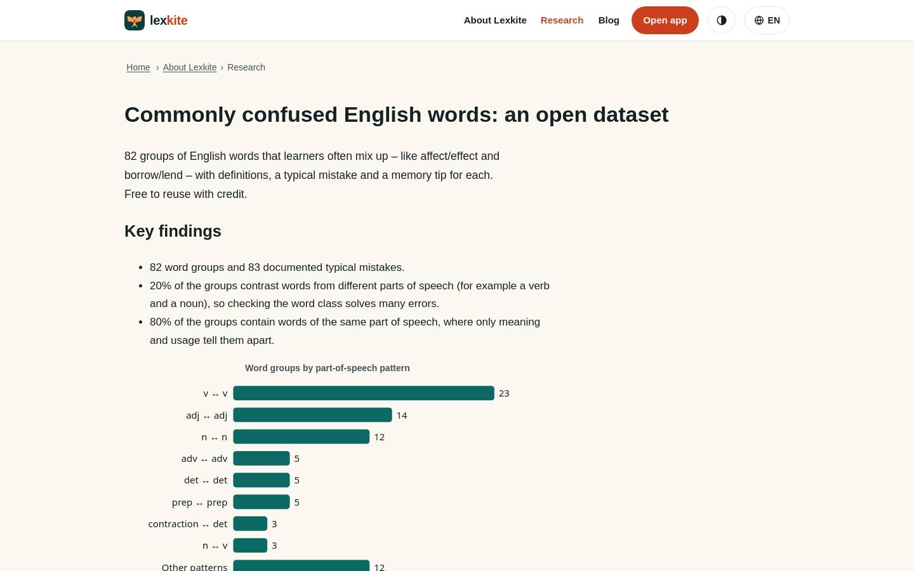
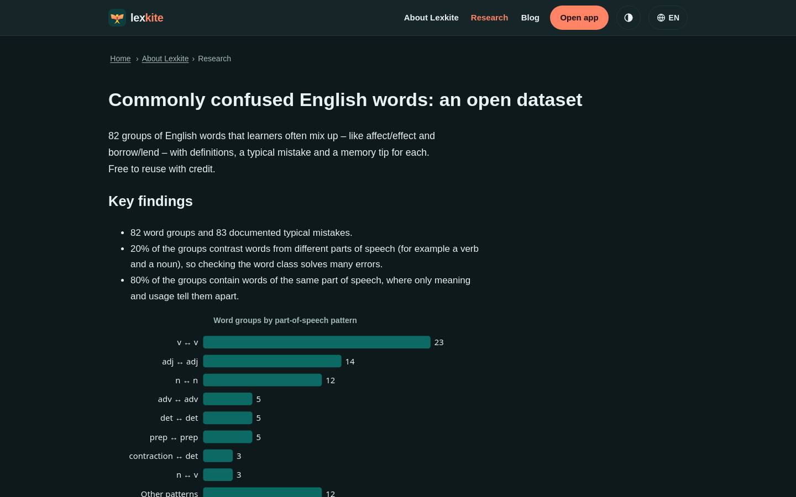

# /L/research/*/

Điểm: **92** · độ phủ 100 % · /en/research/confused-words/

- Chức năng: 100
- Lỗi JS: 100
- Rỗng/lỗi/tải: –
- Back/Thoát: –
- Tương phản: 100
- Chạm ≥44: 92
- Bố cục: 85
- i18n 15: 100
- Hiệu năng: 100
- Độ đẹp: 60

## Lỗi
- [tap] section>p>a – "CC BY 4.0" vùng chạm 80×19 < 44px
- [layout] main#nd>section>div.tbl – nội dung tràn ngang 348px bị cắt: "Typical mistake → correction", "Memory tip", "It has a big affect on me."
- [beauty] Looks like a default HTML page, not a polished app UI
- [beauty] No visual hierarchy; plain text and bullets only
- [beauty] No cards, icons, or character integration; raw layout

## Ảnh
390l 
390d 
1440l 
1440d 
