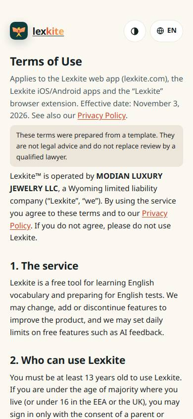
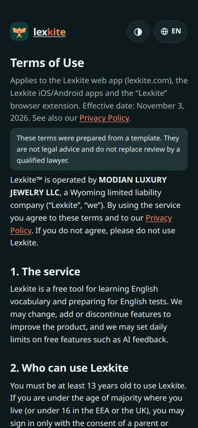
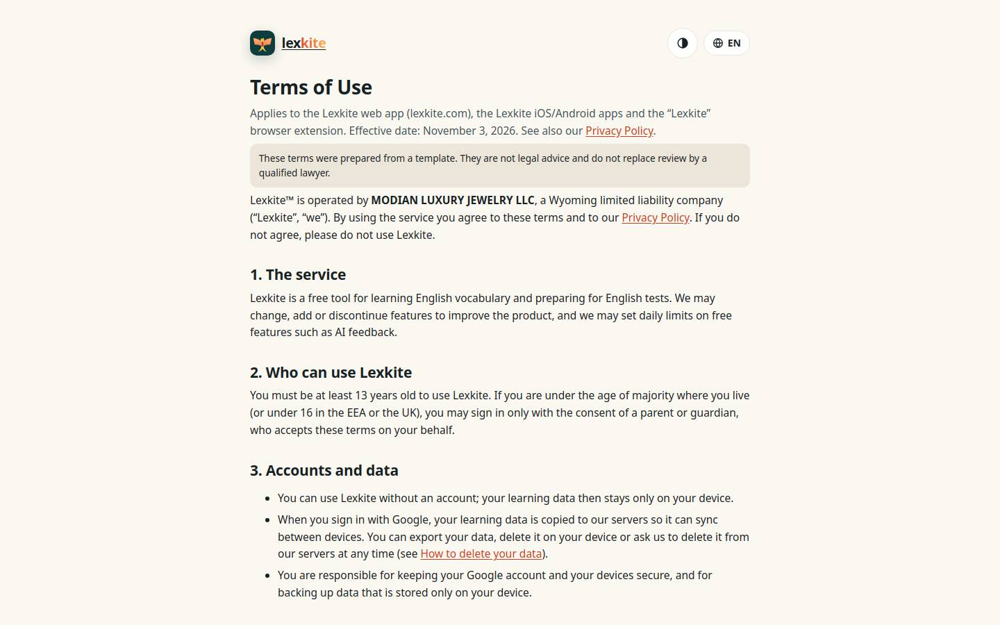
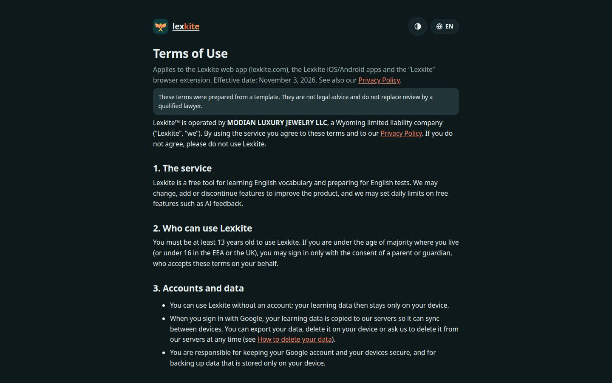

# /L/terms.html

Điểm: **88** · độ phủ 84 % · /en/terms.html

- Chức năng: 100
- Lỗi JS: 100
- Rỗng/lỗi/tải: –
- Back/Thoát: –
- Tương phản: 100
- Chạm ≥44: 84
- Bố cục: 100
- i18n 15: 13
- Hiệu năng: 100
- Độ đẹp: ∅

## Lỗi
- [tap] main.doc>div.lg>a.brand – "lexkite" vùng chạm 109×36 < 44px
- [tap] div.tbx>div.lsw>button.lsw-b – "EN" vùng chạm 67×36 < 44px
- [i18n] ar: lang="en"
- [i18n] de: lang="en"
- [i18n] es: lang="en"
- [i18n] fr: lang="en"

## Ảnh
390l 
390d 
1440l 
1440d 
