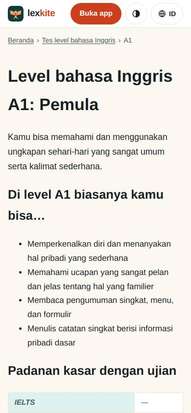
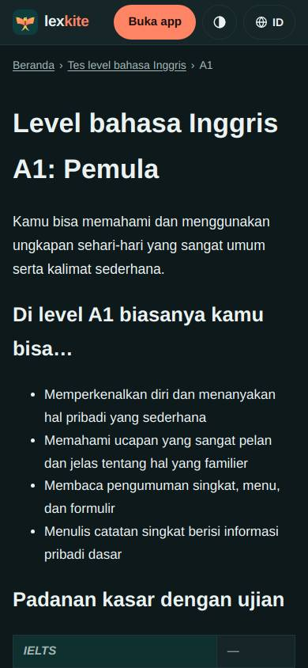
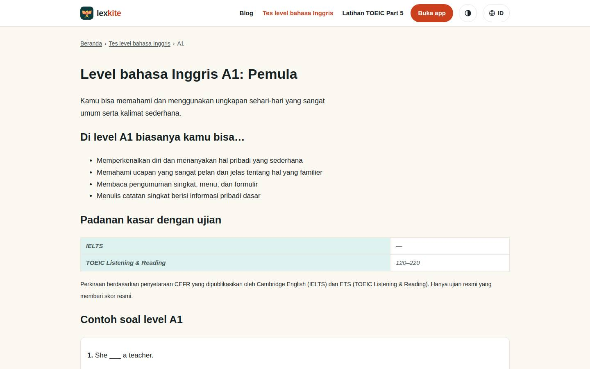
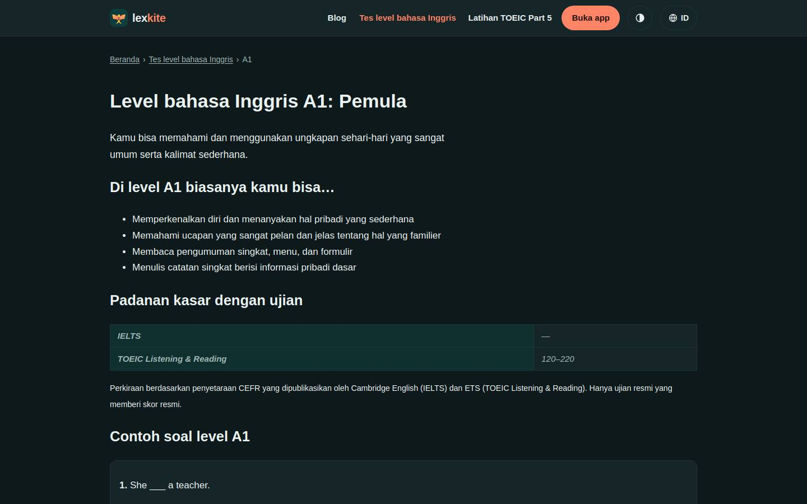

# /L/tes-level-bahasa-inggris/*/

Điểm: **92** · độ phủ 100 % · /id/tes-level-bahasa-inggris/a1/

- Chức năng: 90
- Lỗi JS: 100
- Rỗng/lỗi/tải: –
- Back/Thoát: –
- Tương phản: 100
- Chạm ≥44: 100
- Bố cục: 100
- i18n 15: 100
- Hiệu năng: 100
- Độ đẹp: 60

## Lỗi
- [fn] link hỏng: /id/words/
- [beauty] Looks like a default HTML page, not a polished app UI
- [beauty] No illustration or character integration
- [beauty] Generic bullet list and plain table, no visual hierarchy

## Ảnh
390l 
390d 
1440l 
1440d 
