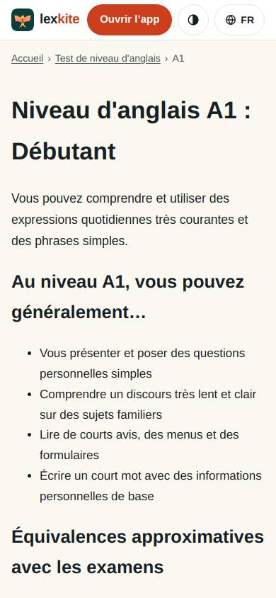
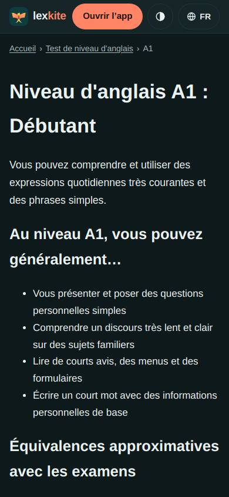
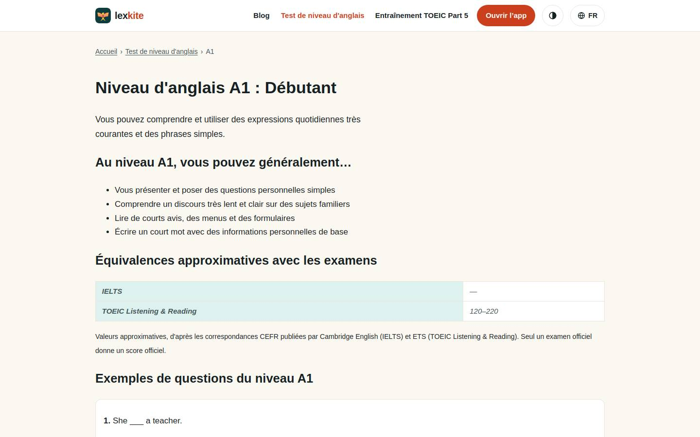
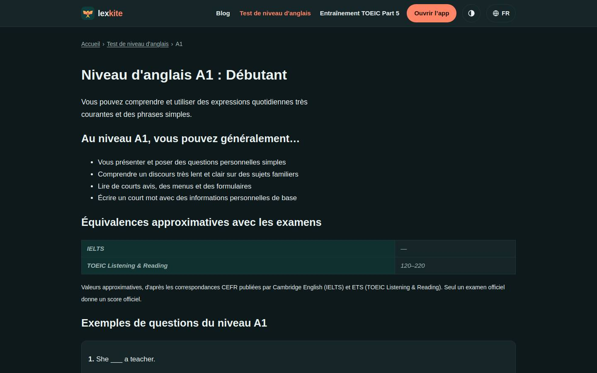

# /L/test-de-niveau-anglais/*/

Điểm: **91** · độ phủ 100 % · /fr/test-de-niveau-anglais/a1/

- Chức năng: 100
- Lỗi JS: 100
- Rỗng/lỗi/tải: –
- Back/Thoát: –
- Tương phản: 100
- Chạm ≥44: 100
- Bố cục: 100
- i18n 15: 100
- Hiệu năng: 100
- Độ đẹp: 46

## Lỗi
- [beauty] Looks like a default HTML page, not an app UI
- [beauty] No visual hierarchy or primary action
- [beauty] No cards, icons, or character integration

## Ảnh
390l 
390d 
1440l 
1440d 
