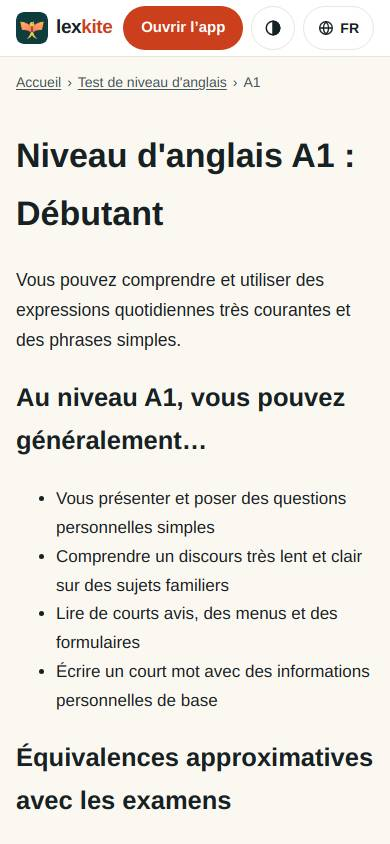
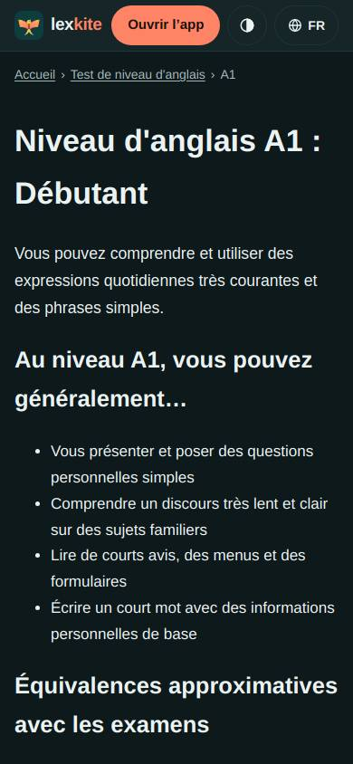
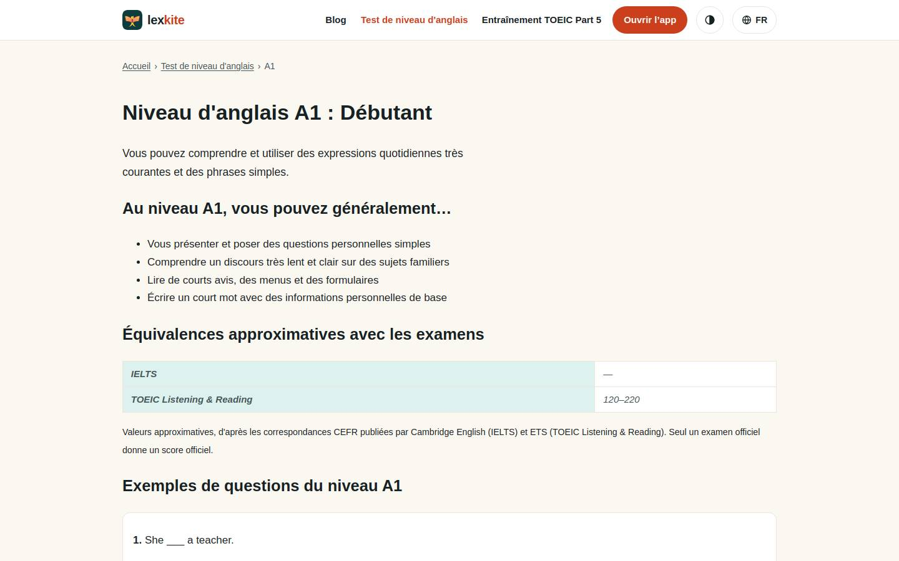
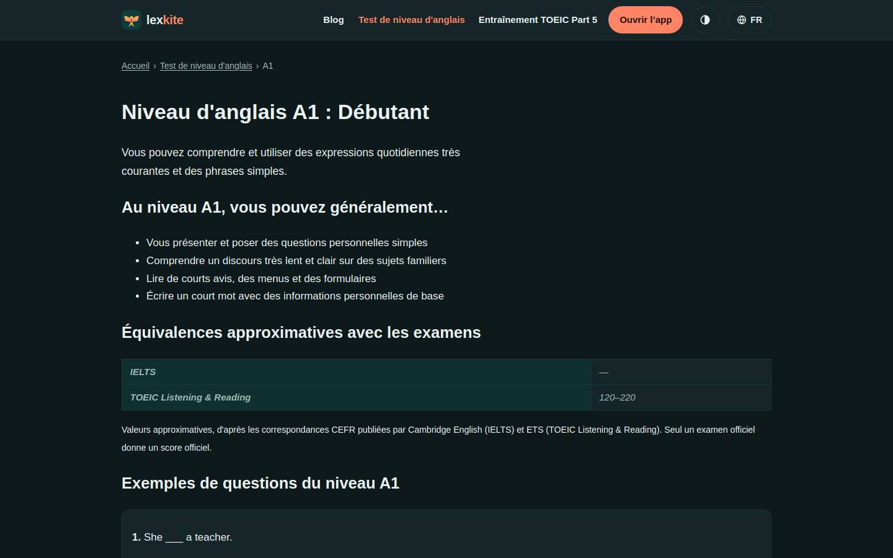

# /L/test-de-niveau-anglais/*/

Điểm: **90** · độ phủ 100 % · /fr/test-de-niveau-anglais/a1/

- Chức năng: 90
- Lỗi JS: 100
- Rỗng/lỗi/tải: –
- Back/Thoát: –
- Tương phản: 100
- Chạm ≥44: 100
- Bố cục: 100
- i18n 15: 100
- Hiệu năng: 100
- Độ đẹp: 48

## Lỗi
- [fn] link hỏng: /fr/words/
- [beauty] Lacks Duolingo's playful character integration and gamified visual elements
- [beauty] Generic, text-heavy layout resembling a standard web article
- [beauty] No clear primary action or interactive app-like components

## Ảnh
390l 
390d 
1440l 
1440d 
