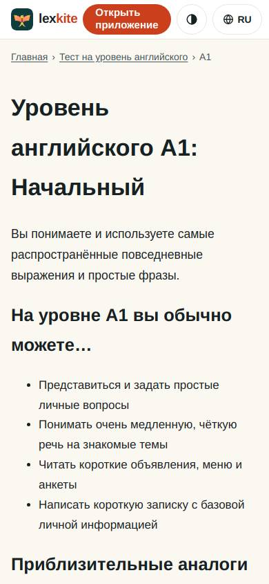
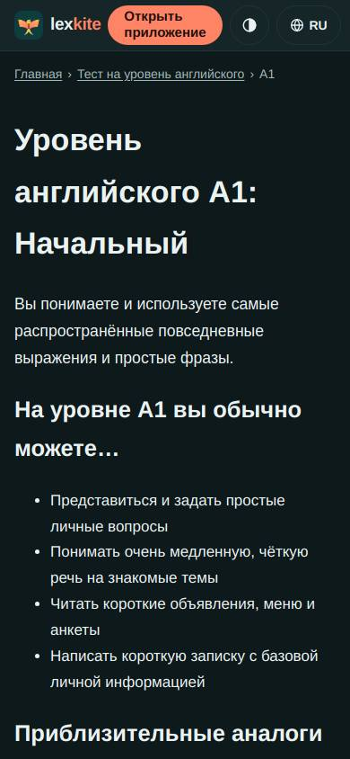
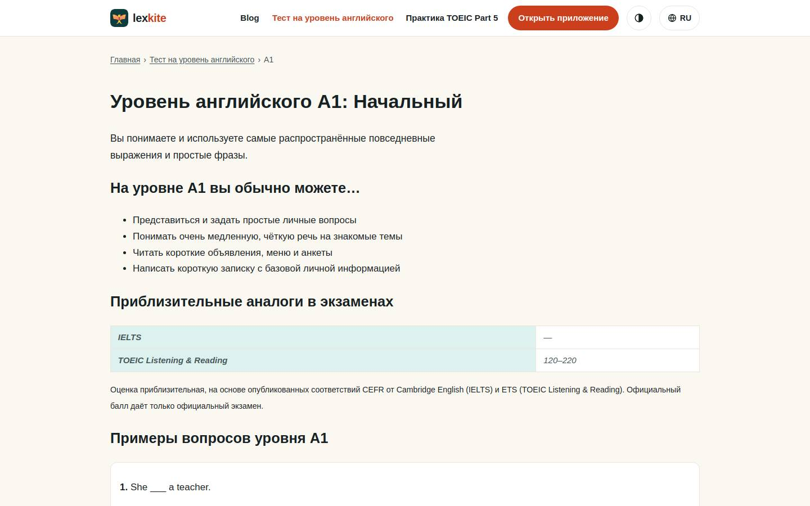
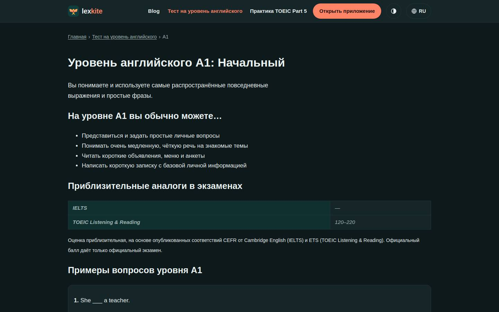

# /L/test-na-uroven-angliyskogo/*/

Điểm: **95** · độ phủ 100 % · /ru/test-na-uroven-angliyskogo/a1/

- Chức năng: 100
- Lỗi JS: 100
- Rỗng/lỗi/tải: –
- Back/Thoát: –
- Tương phản: 100
- Chạm ≥44: 100
- Bố cục: 100
- i18n 15: 100
- Hiệu năng: 100
- Độ đẹp: 71

## Lỗi
- [beauty] Generic web layout, no Duolingo-style cards or character
- [beauty] Plain bullet list feels like a default HTML page
- [beauty] No clear primary action button in the content area

## Ảnh
390l 
390d 
1440l 
1440d 
