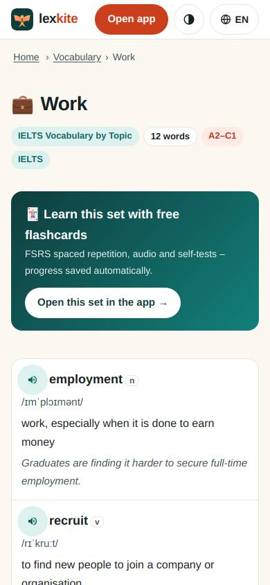
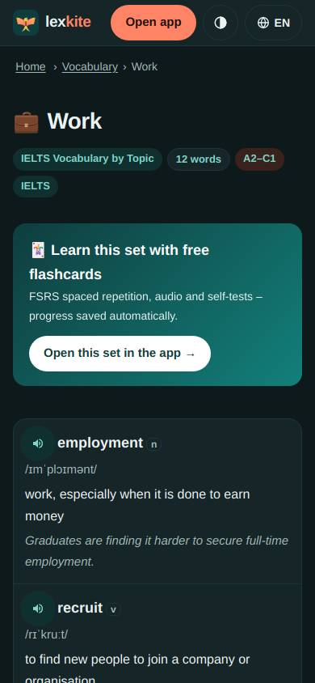
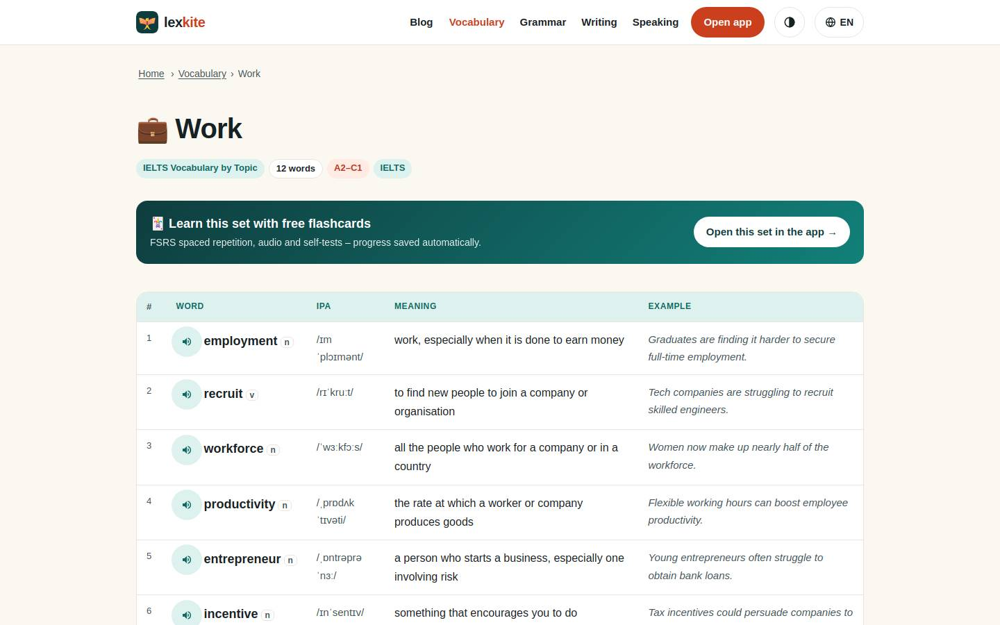
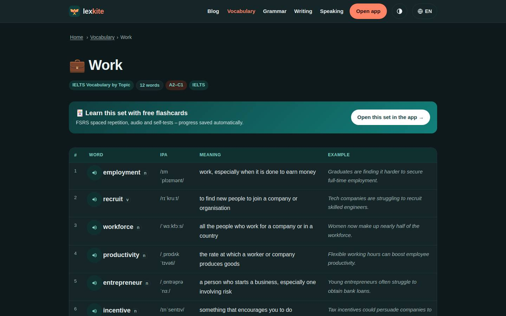

# /L/vocabulary/*

Điểm: **95** · độ phủ 100 % · /en/vocabulary/work.html

- Chức năng: 100
- Lỗi JS: 100
- Rỗng/lỗi/tải: –
- Back/Thoát: –
- Tương phản: 100
- Chạm ≥44: 84
- Bố cục: 100
- i18n 15: 100
- Hiệu năng: 100
- Độ đẹp: 72

## Lỗi
- [tap] aside#pwa>div.cta-actions>button.btn-hide – "Hide" vùng chạm 39×30 < 44px
- [tap] aside#ext>div.cta-actions>button.btn-hide – "Hide" vùng chạm 41×26 < 44px
- [beauty] Generic web layout, not Duolingo's playful app aesthetic
- [beauty] Flat, utilitarian cards lack character integration
- [beauty] Visual hierarchy is functional but generic

## Ảnh
390l 
390d 
1440l 
1440d 
