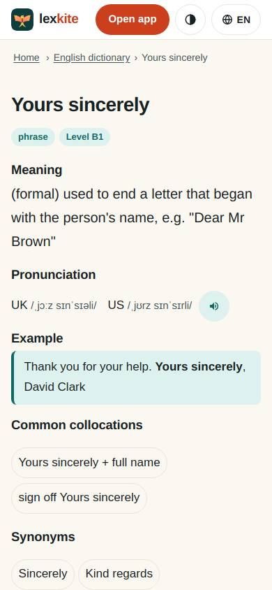
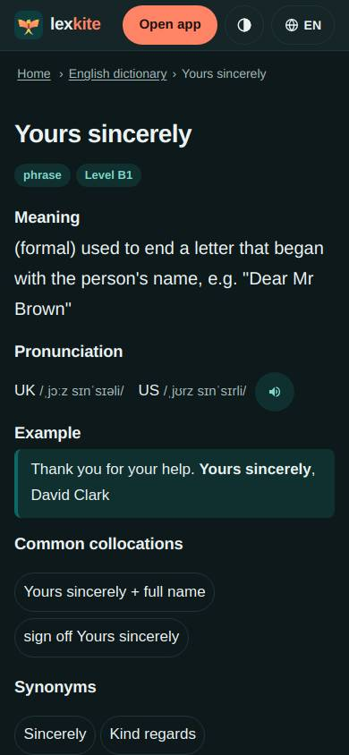
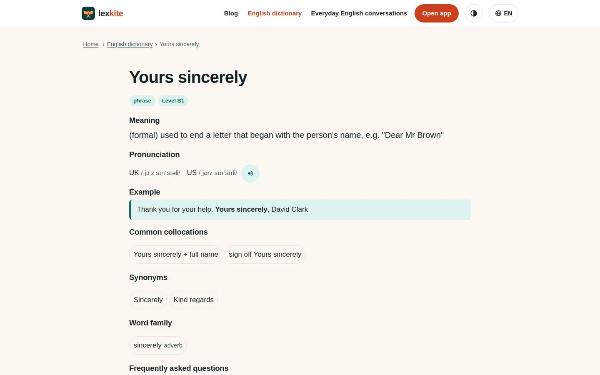
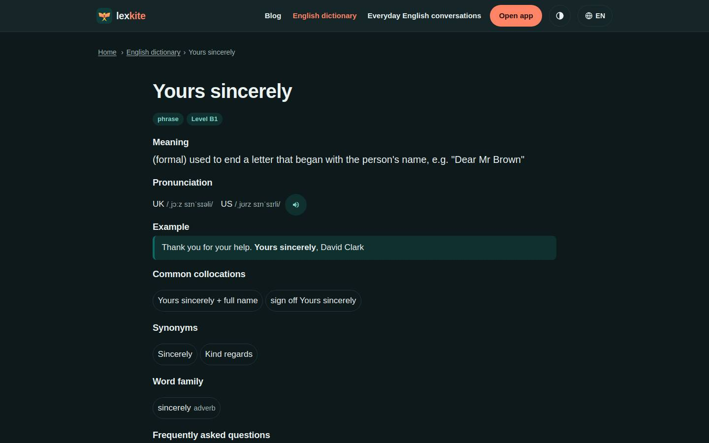

# /L/words/*

Điểm: **95** · độ phủ 100 % · /en/words/yours-sincerely.html

- Chức năng: 100
- Lỗi JS: 100
- Rỗng/lỗi/tải: –
- Back/Thoát: –
- Tương phản: 100
- Chạm ≥44: 84
- Bố cục: 100
- i18n 15: 100
- Hiệu năng: 100
- Độ đẹp: 72

## Lỗi
- [tap] article.page.wd>p.golink>a – "Learn your first English words in 60 sec" vùng chạm 355×19 < 44px
- [tap] ul>li>a – "English level B1: Intermediate" vùng chạm 225×19 < 44px
- [beauty] Generic web-dictionary layout, not a gamified app screen
- [beauty] No character or illustration integration
- [beauty] Flat pill buttons lack Duolingo-style depth/polish

## Ảnh
390l 
390d 
1440l 
1440d 
