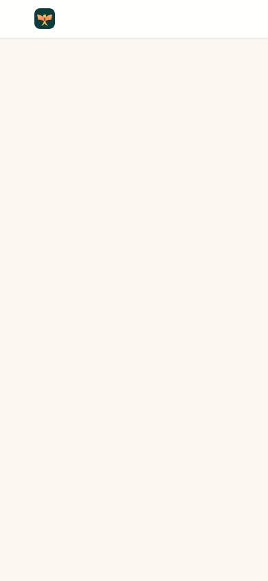
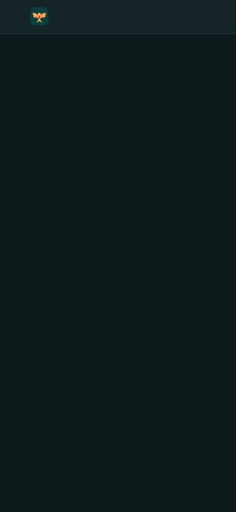
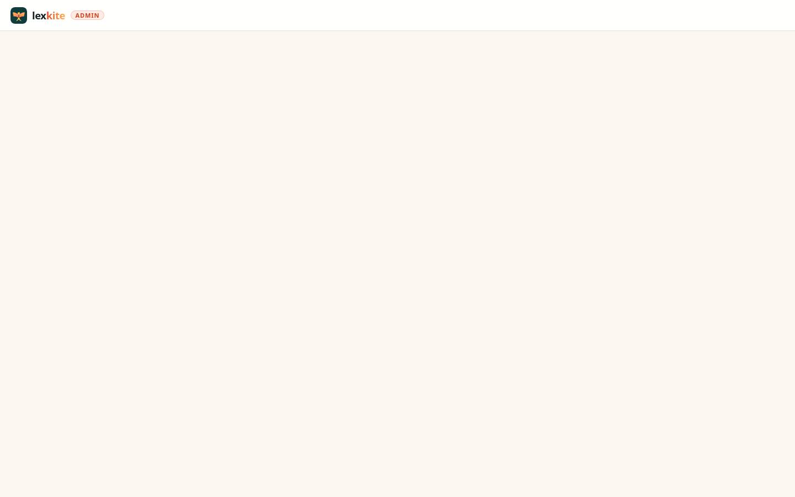
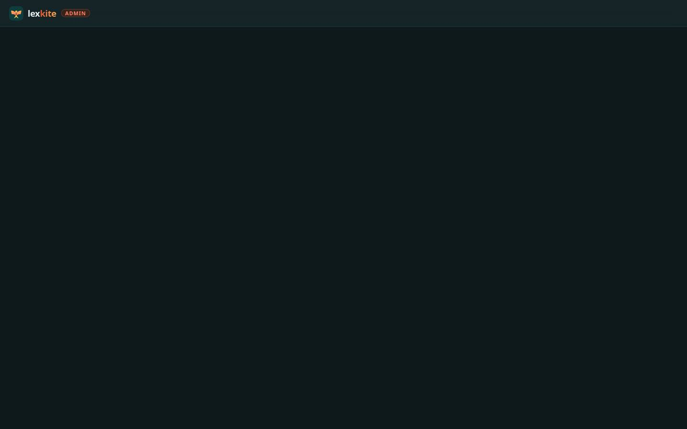

# /admin.html

Điểm: **81** · độ phủ 89 % · /admin.html

- Chức năng: 100
- Lỗi JS: 75
- Rỗng/lỗi/tải: –
- Back/Thoát: –
- Tương phản: 90
- Chạm ≥44: 84
- Bố cục: 100
- i18n 15: ∅
- Hiệu năng: 100
- Độ đẹp: 30

## Lỗi
- [js] firebase is not defined
- [contrast] .adm-tag
- [tap] a.adm-skip[Bỏ qua tới nội dung] – "Skip to content" vùng chạm 133×39 < 44px
- [tap] header.adm-top>a.brand.adm-brand – "lexkite" vùng chạm 99×30 < 44px
- [beauty] Screen is almost entirely empty with no content
- [beauty] No visible primary action or call to action
- [beauty] Layout appears broken or unfinished

## Ảnh
390l 
390d 
1440l 
1440d 
