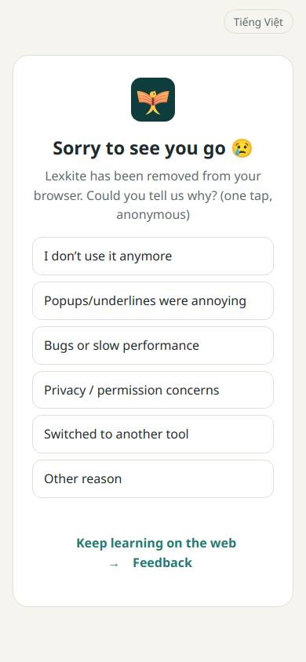
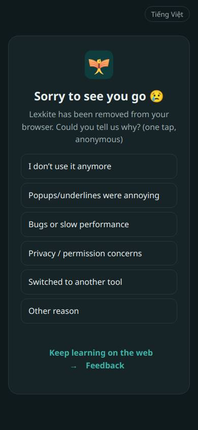
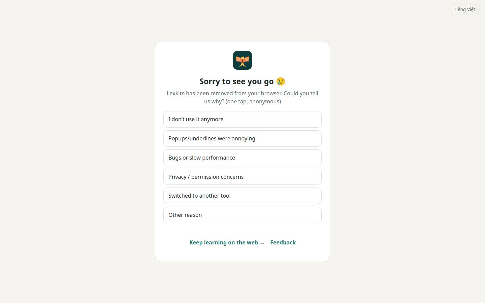
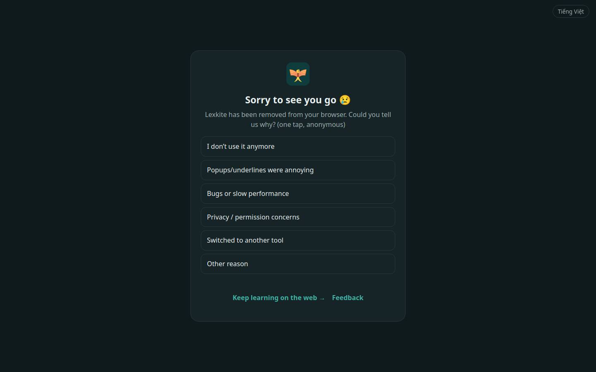

# /bye.html

Điểm: **99** · độ phủ 74 % · /bye.html

- Chức năng: 100
- Lỗi JS: 100
- Rỗng/lỗi/tải: –
- Back/Thoát: –
- Tương phản: 100
- Chạm ≥44: 84
- Bố cục: 100
- i18n 15: ∅
- Hiệu năng: 100
- Độ đẹp: ∅

## Lỗi
- [tap] button#lng – "Tiếng Việt" vùng chạm 89×31 < 44px
- [tap] main.box>p.links>a – "Keep learning on the web →" vùng chạm 224×22 < 44px

## Ảnh
390l 
390d 
1440l 
1440d 
