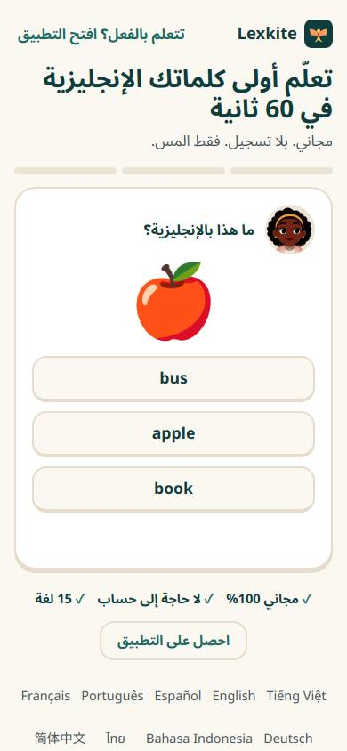
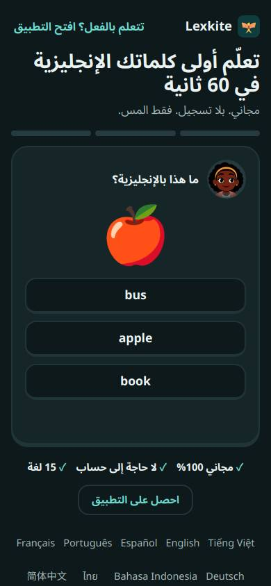
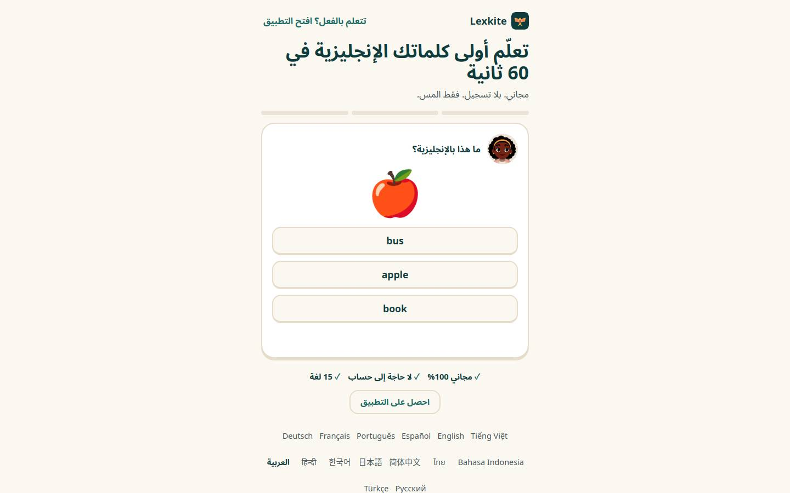
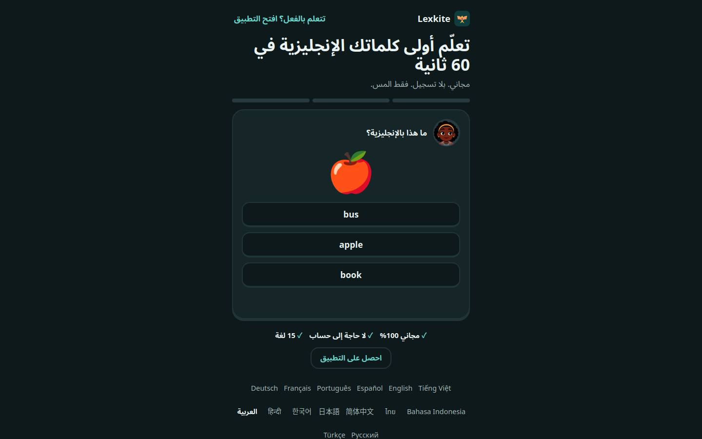

# /go/*/

Điểm: **96** · độ phủ 89 % · /go/ar/

- Chức năng: 100
- Lỗi JS: 100
- Rỗng/lỗi/tải: –
- Back/Thoát: –
- Tương phản: 100
- Chạm ≥44: 100
- Bố cục: 100
- i18n 15: ∅
- Hiệu năng: 100
- Độ đẹp: 77

## Lỗi
- [beauty] Character avatar feels pasted on, not integrated with the card
- [beauty] Beige palette and thin borders look generic, less punch than Duolingo
- [beauty] Top nav tagline and logo compete with the main headline

## Ảnh
390l 
390d 
1440l 
1440d 
