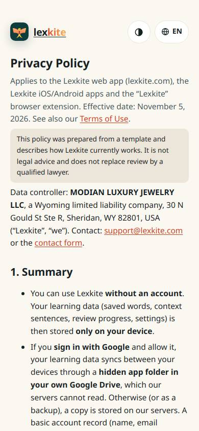
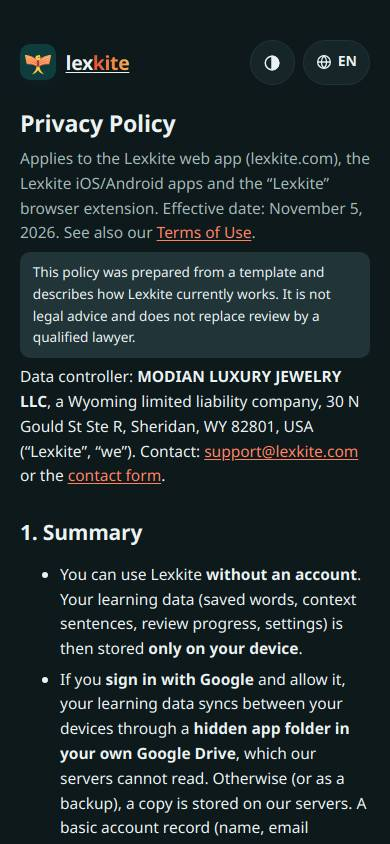
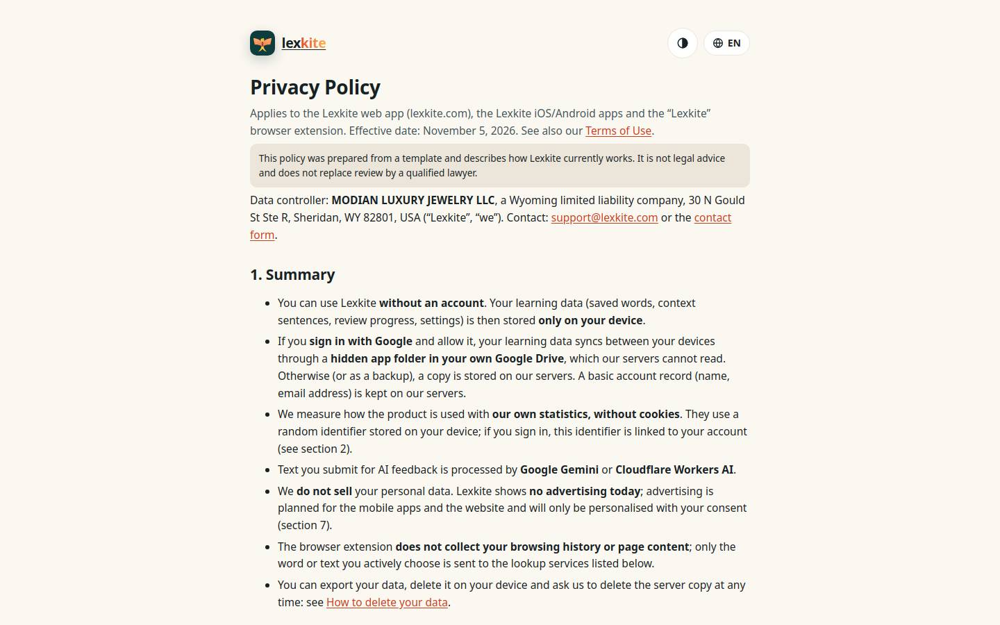
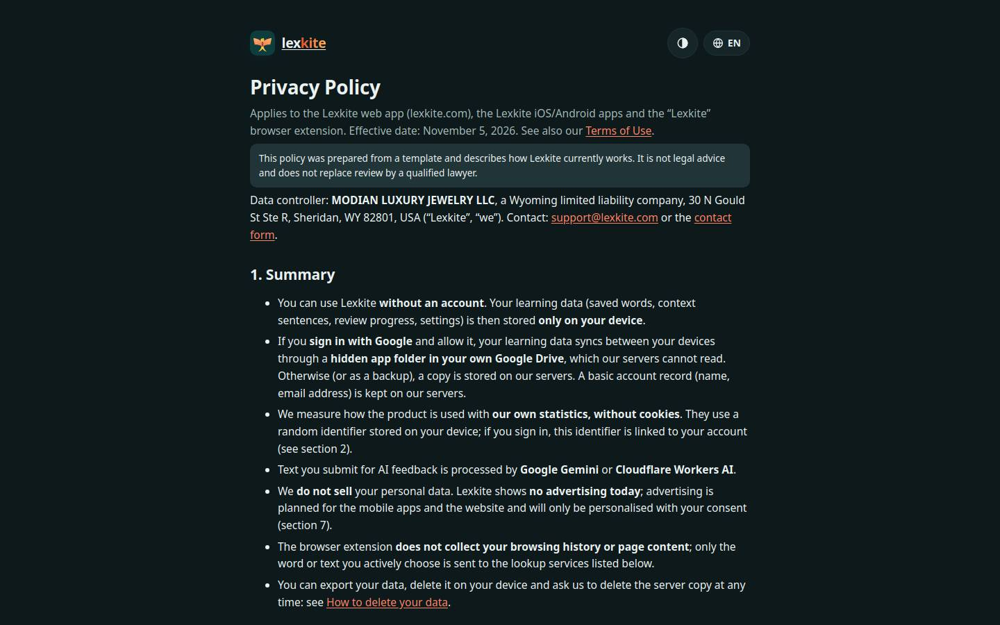

# /privacy.html

Điểm: **86** · độ phủ 89 % · /privacy.html

- Chức năng: 100
- Lỗi JS: 100
- Rỗng/lỗi/tải: –
- Back/Thoát: –
- Tương phản: 100
- Chạm ≥44: 84
- Bố cục: 85
- i18n 15: ∅
- Hiệu năng: 100
- Độ đẹp: 38

## Lỗi
- [tap] main.doc>div.lg>a.brand – "lexkite" vùng chạm 109×36 < 44px
- [tap] div.tbx>div.lsw>button.lsw-b – "EN" vùng chạm 67×36 < 44px
- [layout] main.doc>table – nội dung tràn ngang 20px bị cắt: "Where it is stored", "On your device (browser storage, app sto", "Firebase Authentication
- [beauty] Screenshot is vertically duplicated, showing the same content twice.
- [beauty] Content is a raw legal text dump, not a designed app screen.
- [beauty] No primary action, cards, or illustration; looks like a default web page.

## Ảnh
390l 
390d 
1440l 
1440d 
