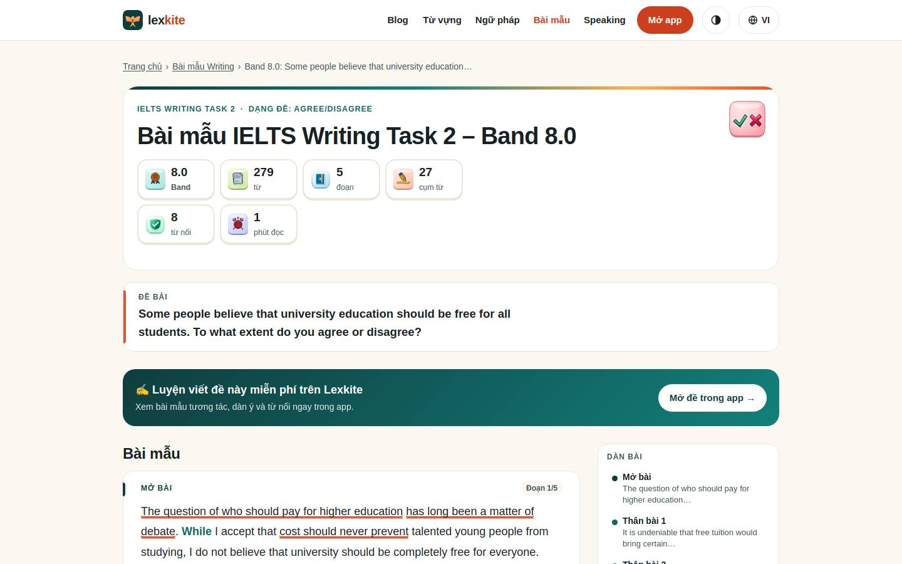
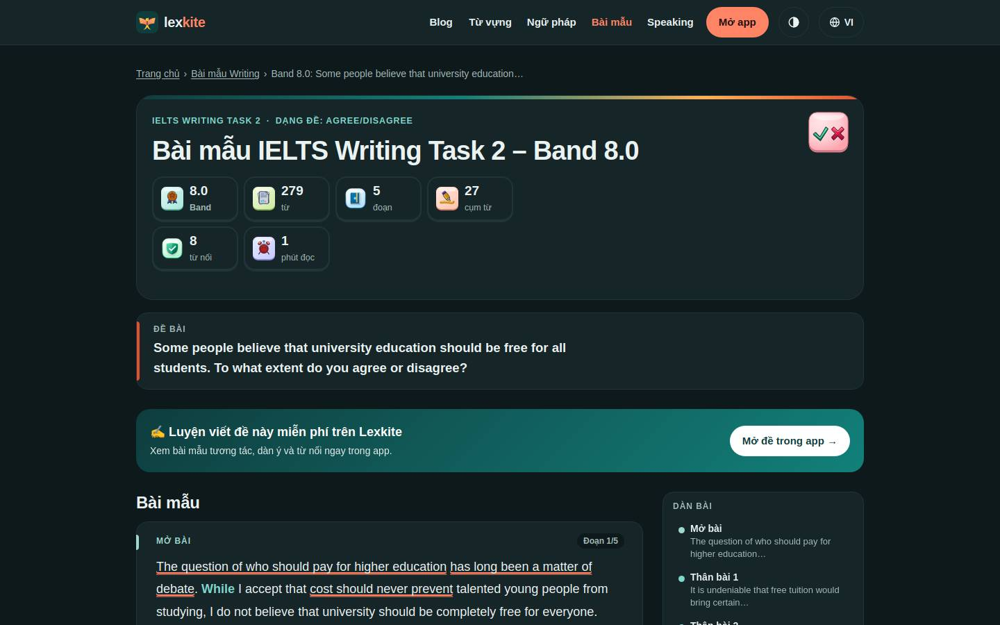

# /samples/*

Điểm: **95** · độ phủ 74 % · /samples/p1.html

- Chức năng: 100
- Lỗi JS: 100
- Rỗng/lỗi/tải: –
- Back/Thoát: –
- Tương phản: 100
- Chạm ≥44: 36
- Bố cục: 100
- i18n 15: ∅
- Hiệu năng: 100
- Độ đẹp: ∅

## Lỗi
- [tap] section#d2>p>mark.ph – "It is undeniable that" vùng chạm 147×19 < 44px
- [tap] section#d3>p>mark.ph – "ordinary workers" vùng chạm 126×19 < 44px
- [tap] section#d4>p>mark.ph – "A fairer approach" vùng chạm 129×19 < 44px
- [tap] section#d5>p>mark.ph – "appears attractive" vùng chạm 135×19 < 44px
- [tap] aside#pwa>div.cta-actions>button.btn-hide – "Ẩn" vùng chạm 28×30 < 44px

## Ảnh
390l 
390d 
1440l 
1440d 
