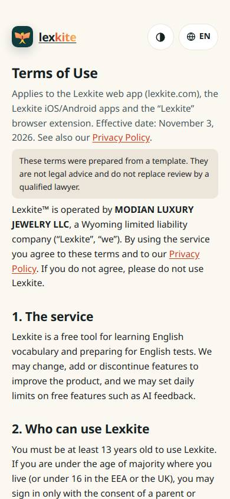
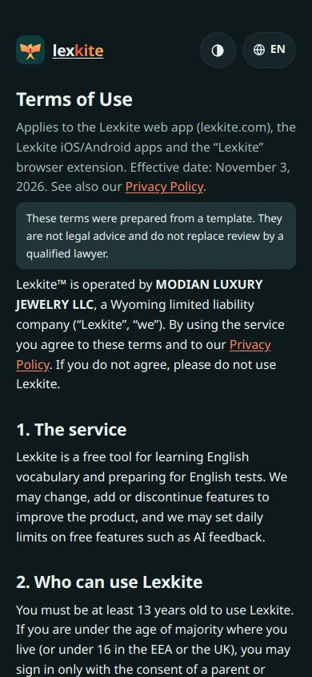
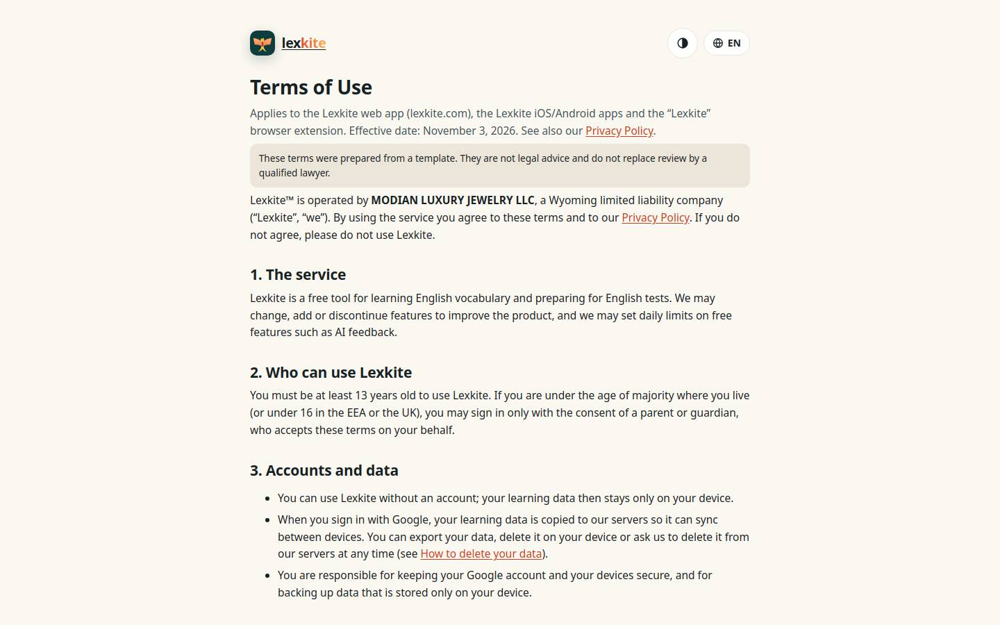
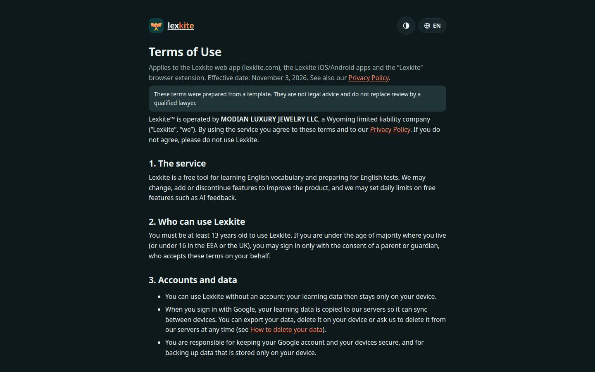

# /terms.html

Điểm: **92** · độ phủ 89 % · /terms.html

- Chức năng: 100
- Lỗi JS: 100
- Rỗng/lỗi/tải: –
- Back/Thoát: –
- Tương phản: 100
- Chạm ≥44: 84
- Bố cục: 100
- i18n 15: ∅
- Hiệu năng: 100
- Độ đẹp: 58

## Lỗi
- [tap] main.doc>div.lg>a.brand – "lexkite" vùng chạm 109×36 < 44px
- [tap] div.tbx>div.lsw>button.lsw-b – "EN" vùng chạm 67×36 < 44px
- [beauty] No primary action; screen is a static legal text dump
- [beauty] Generic system typography, lacks Duolingo's playful character
- [beauty] Flat beige palette feels dull and low-contrast

## Ảnh
390l 
390d 
1440l 
1440d 
