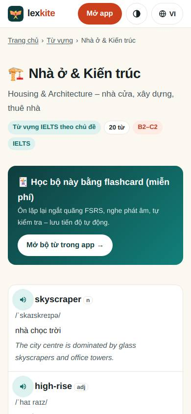
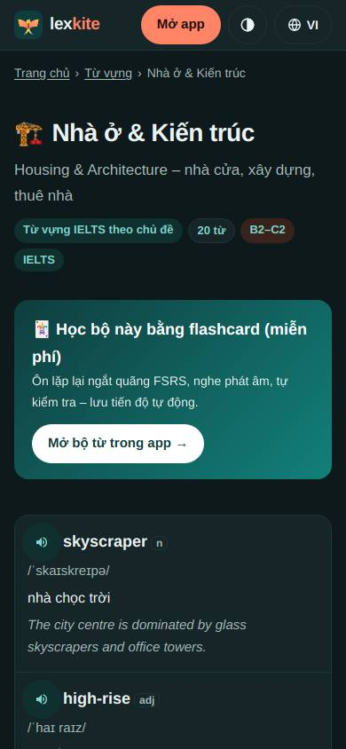
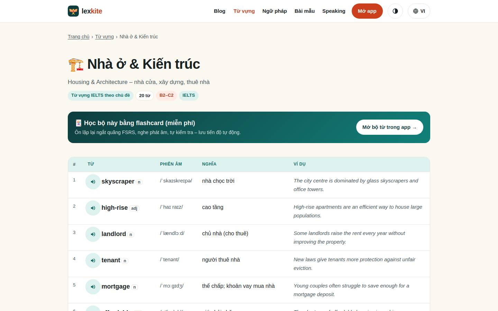
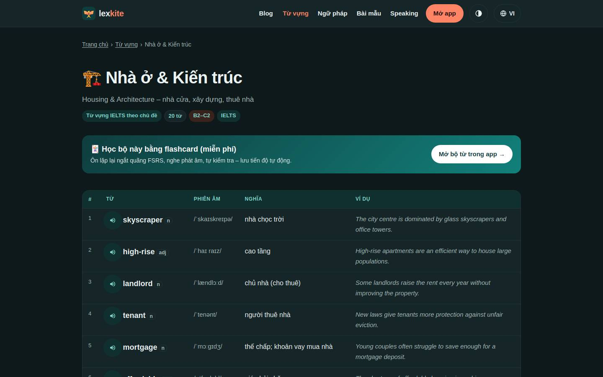

# /tu-vung/*

Điểm: **99** · độ phủ 74 % · /tu-vung/architecture.html

- Chức năng: 100
- Lỗi JS: 100
- Rỗng/lỗi/tải: –
- Back/Thoát: –
- Tương phản: 100
- Chạm ≥44: 84
- Bố cục: 100
- i18n 15: ∅
- Hiệu năng: 100
- Độ đẹp: ∅

## Lỗi
- [tap] aside#pwa>div.cta-actions>button.btn-hide – "Ẩn" vùng chạm 28×30 < 44px
- [tap] aside#ext>div.cta-actions>button.btn-hide – "Ẩn" vùng chạm 29×26 < 44px

## Ảnh
390l 
390d 
1440l 
1440d 
