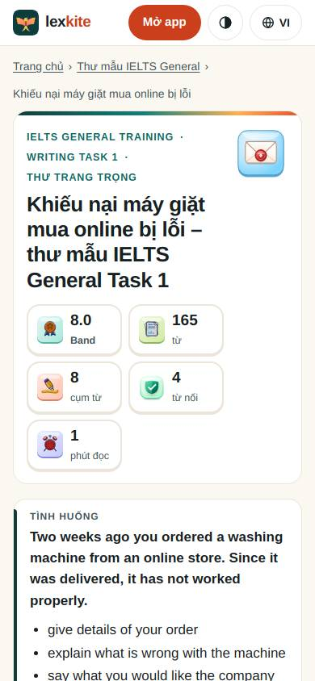
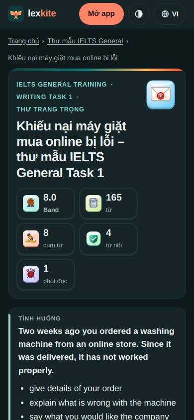
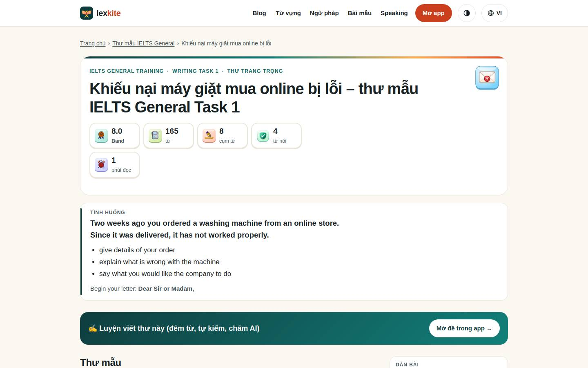
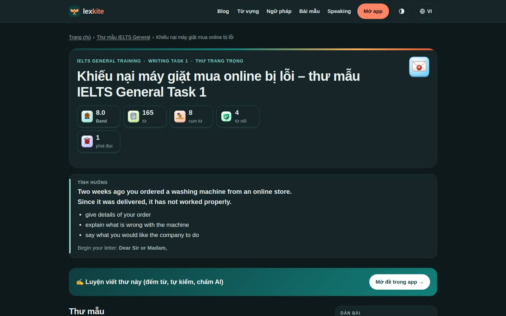

# /viet-thu/*

Điểm: **92** · độ phủ 89 % · /viet-thu/gt1.html

- Chức năng: 100
- Lỗi JS: 100
- Rỗng/lỗi/tải: –
- Back/Thoát: –
- Tương phản: 100
- Chạm ≥44: 44
- Bố cục: 100
- i18n 15: ∅
- Hiệu năng: 100
- Độ đẹp: 74

## Lỗi
- [tap] aside#pwa>div.cta-actions>button.btn-hide – "Ẩn" vùng chạm 28×30 < 44px
- [tap] div.side-box.legend>div.tools>button – "Tô màu" vùng chạm 87×32 < 44px
- [tap] section#d2>p>mark.ph – "express my dissatisfaction with" vùng chạm 247×20 < 44px
- [tap] section#d4>p>mark.ph – "leaks onto the kitchen floor" vùng chạm 214×20 < 44px
- [tap] section#d5>p>mark.ph – "as soon as possible" vùng chạm 158×20 < 44px
- [beauty] Generic web layout, not app-like Duolingo polish
- [beauty] No clear single primary action; header CTA competes
- [beauty] Card icons look pasted, uneven visual weight

## Ảnh
390l 
390d 
1440l 
1440d 
